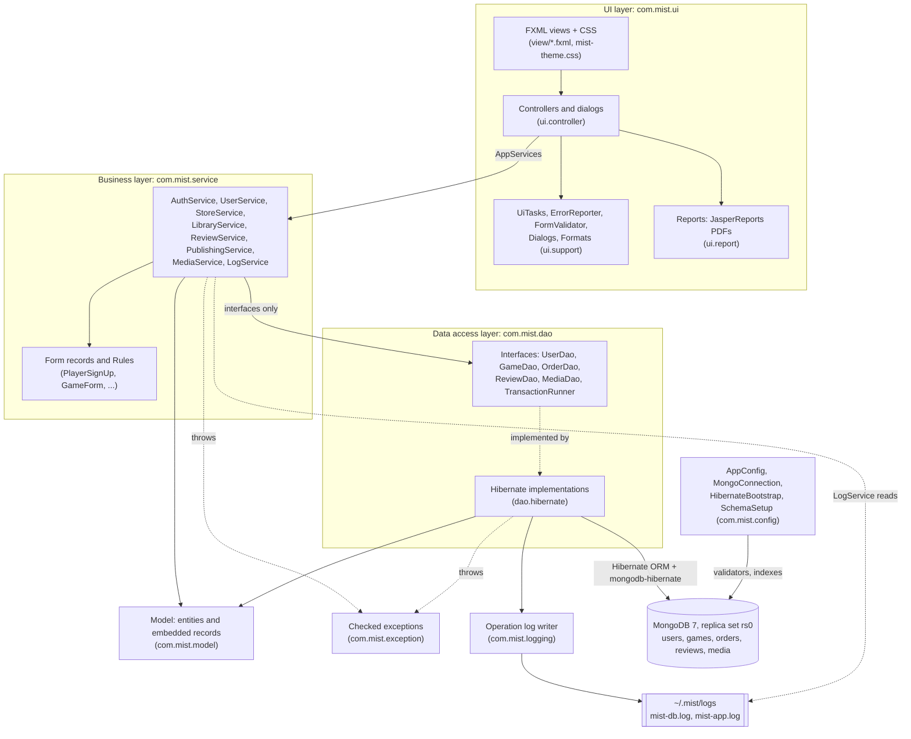

# MIST architecture

MIST is a desktop store and community for PC games. Players buy, return and review games, developer studios publish
them and follow their sales, and admins read the database operation log. It is a JavaFX application in four layers
over MongoDB.

This document is the final architecture document of Reto 2.3 "MongoQuest". It explains how to install MIST, how its
layers fit together, and why it is built this way. The details live in three companion documents:

| Document | What it holds |
| --- | --- |
| [data-model.md](data-model.md) | Every collection and field, embedded or referenced and why, transactions, validators, indexes, the operation log format |
| [ui-design.md](ui-design.md) | The aspect and behavior of every screen, with the exact controls, events and service methods |
| [decisions.md](decisions.md) | Every design decision, in the order it was taken, and how the project departs from the preliminary plan |

## Installation

The [README](../README.md) has the full steps. In short:

1. Install [Temurin JDK 25](https://adoptium.net/) and Docker Desktop. Maven is not needed: the wrapper downloads it.
2. Start MongoDB 7 as the single-node replica set `rs0`, which transactions need:
   `docker compose up -d` in the project folder. A local MongoDB install also works once it is configured as `rs0`.
3. Run MIST with `./mvnw javafx:run` (`mvnw.cmd javafx:run` on Windows). On first start it creates the collections,
   validators and indexes, and fills an empty database with demo data. The demo accounts share the password
   `mist2026`: `admin@mist.com`, `lucia@mist.com` (player) and `rockstarnorth@mist.com` (developer).
4. To hand MIST to a user without Java, build the app image with `./mvnw -Ppackage package` and give them
   `target/MIST-0.1.0-windows.zip`. They unzip it and run `MIST.exe`; MongoDB must still be reachable.

Settings (connection string, database name, demo data) come from `mist.properties` and can be overridden with
environment variables or system properties. Logs go to `~/.mist/logs`.

## Layers



| Layer | Package | Responsibility |
| --- | --- | --- |
| UI | `com.mist.ui` | FXML views built with Scene Builder, styled with TailwindFX utilities and the MIST theme; one controller per view; every service call runs on a worker thread; errors reach one `ErrorReporter`; PDF reports |
| Business logic | `com.mist.service` | One service per area of use cases. Each method checks the acting user's account and role, applies the rules, and runs multi-document changes in one transaction |
| Data access | `com.mist.dao`, `com.mist.dao.hibernate` | One DAO interface per collection, implemented with Hibernate ORM and the MongoDB extension; error translation; the operation log |
| Database | MongoDB 7 | Five collections with strict `$jsonSchema` validators and the indexes the queries and unique rules need |

Shared by the layers: `model` (entities and their invariants), `exception` (checked exceptions whose message is a
bundle key), `logging` (the operation log writer) and `config` (settings, the shared client, the schema setup).
`MistContext` in `com.mist` opens the data layer and builds every service; the UI only sees the services, through
`AppServices`.

### Layer rules

`LayerRulesTest` (ArchUnit) fails the build when a rule breaks:

- `ui` never touches `dao`; data reaches the UI only through services.
- `service` never depends on `ui` or on `dao.hibernate`.
- The `dao` interfaces depend only on `model` and `exception`.
- Only `dao.hibernate`, `config` and `model` may use Hibernate or the MongoDB driver.
- Only `com.mist` and `ui` may use JavaFX.
- Every class in `exception` extends `MistException`.

## A use case through the layers: buying the cart

```mermaid
sequenceDiagram
    actor Player
    participant Cart as CartController
    participant Tasks as UiTasks
    participant Store as StoreService
    participant Tx as TransactionRunner
    participant DAOs as UserDao, GameDao, OrderDao
    participant DB as MongoDB
    participant Log as mist-db.log

    Player->>Cart: Check out
    Cart->>Tasks: run(checkout) on a worker thread
    Tasks->>Store: checkout(playerId)
    Store->>Tx: call(work)
    Tx->>Log: BEGIN tx=n
    Store->>DAOs: load player, cart games, check card
    Store->>DAOs: save order, games' stats, player, developers' revenue
    DAOs->>DB: writes in one MongoDB transaction
    DAOs->>Log: one line per operation, tx=n
    Tx->>DB: commit
    Tx->>Log: COMMIT tx=n
    Store-->>Tasks: Order
    Tasks-->>Cart: on the JavaFX thread: receipt dialog
    Note over Tx,DB: On a rule error the transaction rolls back (ROLLBACK tx=n)<br/>and ErrorReporter shows a warning; on a write conflict<br/>the runner retries the whole work, up to 5 times.
```

## Cross-cutting design

- **Errors.** Every failure is a checked `MistException` subclass whose message is a bundle key: `ValidationException`,
  `DuplicateEntityException`, `NotFoundException`, `UnauthorizedException`, `DataAccessException` and
  `InvalidDocumentException`. The DAOs translate Hibernate and driver failures; the services wrap model rule
  violations; `ErrorReporter` decides what the user sees (a warning, an error with Retry, the end of the session).
- **Transactions.** Every use case that loads, changes and saves documents runs in one MongoDB transaction through
  `TransactionRunner`, so it commits all or nothing and never overwrites a newer copy. Conflicts are retried.
- **Operation log.** Every database operation, transaction boundary, login attempt and schema setup step is one line
  of `mist-db.log`, with the date, the user, the transaction number, the operation, the collection, the details and
  the outcome. Admins read and filter it inside MIST.
- **Validation in three places.** The UI checks forms before calling (`FormValidator`), the model refuses invalid
  values, and the MongoDB validators refuse invalid documents. The model and the validators share the same limits and
  patterns, taken from the model's constants.
- **Languages.** Every text comes from `messages_es.properties` and `messages_en.properties`, including the help and
  the PDF report labels; the language switches at once.
- **Tests.** TestFX tests drive every screen on the real services over in-memory DAOs, including rule errors, database
  failures and file errors; an integration test checks the mapping against MongoDB in Testcontainers.

## Why this architecture

The main decisions, with their reasons. [decisions.md](decisions.md) has all of them.

| Decision | Reason |
| --- | --- |
| Hibernate ORM with the MongoDB extension, not the bare driver | The module asks for an ORM (ADT IL5.3); entities, queries and transactions stay in standard JPA/Hibernate terms. The driver is used only where the extension cannot help: validators, special indexes, the catalog search. |
| One `users` collection with `SINGLE_TABLE` inheritance | Players, developers and admins log in the same way; one query and one unique email index serve all three. |
| Embedded data where it is read together | Addresses, cards, library entries, achievements, requirements and order items are always shown with their owner; reviews and images grow without bound, so they have their own collections. |
| Arrays of `_id` for cart, wishlist, catalog and screenshots | Small lists of references that change often, without copying the games. |
| Replica set `rs0` | Multi-document transactions, which checkout, returns, ratings and publishing need. |
| DAO interfaces plus a `TransactionRunner` | The services never see Hibernate, and the UI tests can run on in-memory DAOs. |
| Checked exceptions with bundle keys | The path of every error to the UI shows in the method signatures, and the UI shows it in the user's language. |
| A zipped jpackage app image, not an installer | It runs without Java on any Windows machine and needs no WiX on the build machine. |
