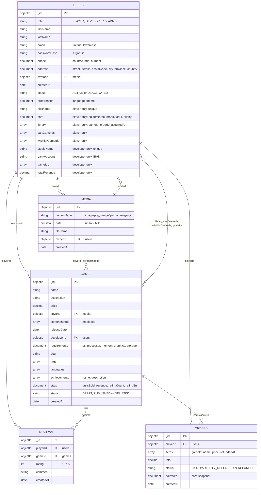

# MIST data model

MIST stores its data in five MongoDB collections. The Java model in `com.mist.model` maps onto them through
Hibernate ORM 7.4 and the MongoDB extension for Hibernate (`mongodb-hibernate` 1.0.0). This page describes the
collections, their fields, what is embedded and what is referenced, and why.

## Collections



| Collection | Java | Holds |
| --- | --- | --- |
| `users` | `User` → `Player`, `Developer`, `Admin` | every account; the `role` field says which kind |
| `games` | `Game` | the catalog, drafts included |
| `orders` | `Order` | purchases and their returns |
| `reviews` | `Review` | one rating and comment per player and game |
| `media` | `Media` | images: game covers, screenshots, profile pictures |

Every document is identified by an `ObjectId` in `_id`. Field names are the same in Java and in MongoDB. Money is
`BigDecimal` at scale 2 and stored as `decimal`; times are `Instant` and stored as `date`. A release date is stored as
midnight UTC of the release day.

## users

Players ("clientes"), developers and admins share one collection through Hibernate's `SINGLE_TABLE` inheritance. The
`role` field is the discriminator: Hibernate reads it to decide which class to load, so `from User where email = :e`
returns a `Player`, `Developer` or `Admin`. One collection means one login query and one unique index on `email` for
every account.

Each document holds the common fields plus the fields of its own role. Fields of other roles are not written at all:
a developer document has no `nickname` key. A field of the document's own role that has no value is written as
`null`, as `phone` is for a player who gave no phone.

| Field | Type | Role | Rules |
| --- | --- | --- | --- |
| `firstName`, `lastName` | string | all | 1–50 and 1–80 characters |
| `email` | string | all | lowercase, unique; the login |
| `passwordHash` | string | all | Argon2id hash in PHC format (`$argon2id$…`); the model refuses anything else |
| `phone` | `{countryCode, number}` | all | optional; `+` and 1–3 digits, then 4–14 digits |
| `address` | `{street, details, postalCode, city, province, country}` | all | required for players and developers; `country` is ISO 3166-1 alpha-2 |
| `avatarId` | objectId → `media` | all | optional profile picture |
| `createdAt` | date | all | |
| `status`, `deactivatedAt` | string, date | all | `ACTIVE` or `DEACTIVATED`; deactivating keeps the document so orders and reviews stay valid |
| `preferences` | `{language, theme}` | all | `ES`/`EN`, `DARK`/`LIGHT`; default `ES`, `DARK` |
| `nickname` | string | player | 3–24 letters, digits, `.`, `-`, `_`; unique |
| `card` | `{holderName, brand, last4, expiryMonth, expiryYear}` | player | the full card number and CVV are never stored |
| `library` | array of `{gameId, orderId, acquiredAt}` | player | owned games |
| `cartGameIds`, `wishlistGameIds` | arrays of objectId → `games` | player | |
| `studioName` | string | developer | 1–80 characters, unique; shown on game pages |
| `bankAccount` | string | developer | IBAN without spaces, checked with mod 97 |
| `gameIds` | array of objectId → `games` | developer | the developer's catalog |
| `totalRevenue` | decimal | developer | sales minus refunds |

A player document as stored:

```json
{
  "_id": { "$oid": "6afbb3aeb55bb8f765fc2c97" },
  "role": "PLAYER",
  "firstName": "Lucia", "lastName": "Martin",
  "email": "lucia@example.com",
  "passwordHash": "$argon2id$v=19$m=19456,t=2,p=1$…",
  "phone": null,
  "address": { "street": "Calle Mayor 1", "details": "2º B", "postalCode": "28013",
               "city": "Madrid", "province": "Madrid", "country": "ES" },
  "avatarId": null,
  "createdAt": { "$date": "2026-11-17T10:00:00Z" },
  "status": "ACTIVE", "deactivatedAt": null,
  "preferences": { "language": "ES", "theme": "DARK" },
  "nickname": "lucia_m",
  "card": { "holderName": "Lucia Martin", "brand": "VISA", "last4": "4242",
            "expiryMonth": 12, "expiryYear": 2030 },
  "library": [ { "gameId": { "$oid": "6afbb3aeb55bb8f765fc2c9a" },
                 "orderId": { "$oid": "6afbb3aeb55bb8f765fc2c9c" },
                 "acquiredAt": { "$date": "2026-11-17T10:00:00Z" } } ],
  "cartGameIds": [],
  "wishlistGameIds": []
}
```

## games

| Field | Type | Rules |
| --- | --- | --- |
| `name` | string | 1–120 characters |
| `description` | string | up to 4000 characters |
| `price` | decimal | 0.00–999.99; 0 is a free game |
| `coverId`, `screenshotIds` | objectId, array of objectId → `media` | up to 8 screenshots |
| `releaseDate` | date | midnight UTC of the release day |
| `developerId` | objectId → `users` | the developer who publishes it |
| `requirements` | `{os, processor, memory, graphics, storage}` | minimum system requirements |
| `pegi` | string | `PEGI_3`, `PEGI_7`, `PEGI_12`, `PEGI_16` or `PEGI_18` |
| `tags` | array of string | up to 10, lowercase; genres, categories and tags in one list |
| `languages` | array of string | ISO 639-1 codes (`es`, `en`, …) |
| `achievements` | array of `{name, description}` | up to 50; shown on the Game view |
| `stats` | `{unitsSold, revenue, ratingCount, ratingSum}` | the average rating is `ratingSum / ratingCount` |
| `status` | string | `DRAFT` → `PUBLISHED` → `DELISTED` |
| `createdAt` | date | |

A draft needs a cover, description, release date, PEGI rating and requirements before it can be published. A delisted
game leaves the store, and players who own it keep it in their library.

## orders

| Field | Type | Rules |
| --- | --- | --- |
| `playerId` | objectId → `users` | the buyer |
| `items` | array of `{gameId, name, price, refundedAt}` | 1–50 games, none repeated; name and price are copied at purchase |
| `total` | decimal | sum of the item prices at purchase |
| `status` | string | `PAID`, `PARTIALLY_REFUNDED` or `REFUNDED` |
| `paidWith` | `{holderName, brand, last4, expiryMonth, expiryYear}` | the card used, for the receipt |
| `createdAt` | date | when the order was paid |

Payment is simulated: placing an order means the card was charged. Returning a game sets that item's `refundedAt`,
and the order becomes partially or fully refunded.

## reviews

| Field | Type | Rules |
| --- | --- | --- |
| `playerId` | objectId → `users` | the author, who must own the game |
| `gameId` | objectId → `games` | |
| `rating` | int | 1–5 |
| `comment` | string | optional, up to 2000 characters |
| `createdAt` | date | |

## media

| Field | Type | Rules |
| --- | --- | --- |
| `contentType` | string | `image/png`, `image/jpeg` or `image/gif`, the formats JavaFX can show |
| `data` | binData | 1 byte to 2 MiB |
| `fileName` | string | original name |
| `ownerId` | objectId → `users` | who uploaded it |
| `createdAt` | date | |

## Embedded or referenced

Data that is read together with its parent and stays small is embedded. Data that grows without bound, is shared, or
is read on its own is referenced by `_id`.

| Data | Choice | Why |
| --- | --- | --- |
| phone, address, preferences, card | embedded in `users` | always read with the account, never shared |
| library | embedded in `users` | read with the player for the Library view and ownership checks; bounded by the games a player buys |
| cart, wishlist | arrays of game `_id` in `users` | game data changes (price, name), so only the reference is kept |
| catalog (`gameIds`) | array of game `_id` in `users` | the developer's dashboard lists them; games are their own documents |
| achievements, requirements | embedded in `games` | small, fixed per game, always shown with it |
| stats | embedded in `games` | a summary kept up to date by each purchase, return and review, so the store never aggregates orders or reviews to show a game |
| reviews | own collection, referencing game and player | grow without bound per game and are read in pages |
| order items | embedded in `orders` with a copy of name and price | a receipt must not change when the game's price or name changes later |
| card in an order | embedded copy in `orders` | the receipt shows the card used, even if the player later changes it |
| images | own collection, referenced from `games` and `users` | binary data up to 2 MiB; loading a game or a list of games must not load its images |

The statement's minimums are met:

- **5 related collections:** `users`, `games`, `orders`, `reviews` and `media`, all linked by `_id` references.
- **Embedded data in 3 collections:** `users`, `games` and `orders`.
- **Arrays of `_id`:** `cartGameIds`, `wishlistGameIds`, `gameIds` and `screenshotIds`.

## Transactions

MongoDB runs as replica set `rs0`, so one Hibernate transaction can change several documents atomically:

| Use case | Documents changed together |
| --- | --- |
| Buy the cart | new `orders` document; the player's `library` and cart; each game's `stats`; each developer's `totalRevenue` |
| Return a game | the order item and status; the player's `library`; the game's `stats`; the developer's `totalRevenue` |
| Rate a game | new `reviews` document; the game's `stats` |
| Publish a game | the `games` document; the developer's `gameIds` |
| Deactivate a developer | the `users` document; the developer's games are delisted |

## Schema validation and indexes

The extension cannot create validators or every index type, so `SchemaSetup.apply` creates them through the MongoDB
driver. It runs on every start: it creates the missing collections, brings the validators up to date with `collMod`,
and creates the indexes, all idempotently.

- **Validators:** one `$jsonSchema` per collection, built from the limits the model exposes as constants (for example
  `Review.MAX_COMMENT_LENGTH`).
  - Optional fields must allow `null`, because Hibernate writes a missing value as `null`: `bsonType: ["string", "null"]`.
  - In `users`, a `oneOf` on `role` requires `nickname` and `card` for players and `studioName` and `bankAccount` for
    developers.
- **Indexes:**

| Collection | Index | Purpose |
| --- | --- | --- |
| `users` | `email` unique | login, one account per address |
| `users` | `nickname` unique, partial on `{nickname: {$type: "string"}}` | a unique index treats a missing field as `null`, so without the filter every non-player would collide |
| `users` | `studioName` unique, partial on `{studioName: {$type: "string"}}` | same reason, for non-developers |
| `games` | `{status, releaseDate}` | "New games" |
| `games` | `{status, "stats.unitsSold"}` | "Top sellers" |
| `games` | `developerId` | developer dashboard |
| `orders` | `{playerId, createdAt}` | purchase history |
| `reviews` | `{gameId, playerId}` unique | one review per player and game |
| `reviews` | `{gameId, createdAt}` | reviews of a game, newest first |
| `media` | `ownerId` | a user's uploads |

## Notes for the DAO layer

A check against a real MongoDB 7 replica set confirmed these queries work through Hibernate:

- `from User where email = :e` (it returns the right subclass), `session.find(User.class, id)`, `from Developer`;
- `from Game where id in :ids`, `where developerId = :d`, `where price = 0`, `order by stats.unitsSold desc`;
- `from Order where playerId = :p order by createdAt desc`;
- `from Review where gameId = :g order by createdAt desc`;
- `setFirstResult` and `setMaxResults`, which become `$skip` and `$limit`, for pages and "top N" lists.

Catalog search needs care:

- `like :param` is not supported (the pattern must be a literal), and `lower(name) like '…'` fails inside the extension.
- `name ilike '<literal>'` works, but building a literal from user input needs escaping.
- **Chosen:** `HibernateGameDao.searchPublished` finds matching ids with the driver,
  `Filters.regex("name", Pattern.quote(query), "i")` on published games, then loads the games with
  `from Game where id in :ids`.

The extension also does not support subqueries or `SELECT DISTINCT`. To show a game's reviews with their authors' nicknames,
load the reviews, then the authors with one `from User where id in :ids` query.
