# Manual de usuario de MIST

MIST es una tienda de juegos de PC para escritorio. Los **jugadores** compran, devuelven y reseñan juegos. Los
**desarrolladores** publican los juegos de su estudio y siguen sus ventas. Los **administradores** leen el registro de
todo lo que ocurre en la base de datos. Cualquiera puede recorrer la tienda como **invitado**.

Este manual explica cada pantalla en el orden en que aparecen. También está en inglés: [user-manual.md](user-manual.md).
Dentro de MIST, pulsa **F1** en cualquier pantalla para ver la ayuda de esa pantalla.

## Índice

1. [Abrir MIST](#1-abrir-mist)
2. [Entrar y crear una cuenta](#2-entrar-y-crear-una-cuenta)
3. [Moverse por MIST](#3-moverse-por-mist)
4. [Para jugadores](#4-para-jugadores)
5. [Para desarrolladores](#5-para-desarrolladores)
6. [Para administradores: el registro de operaciones](#6-para-administradores-el-registro-de-operaciones)
7. [Tu perfil](#7-tu-perfil)
8. [Mensajes y qué hacer](#8-mensajes-y-qué-hacer)
9. [Atajos de teclado](#9-atajos-de-teclado)

## 1. Abrir MIST

Abre **MIST.exe** (o pregunta a quien instaló MIST cómo se abre en tu equipo). MIST necesita que su base de datos
MongoDB esté en marcha; de eso se encarga quien lo instaló (consulta el [README](../README.md)).

Mientras MIST se conecta, una pantalla de inicio muestra el logotipo. Si no consigue llegar a la base de datos, verás
esta pantalla:

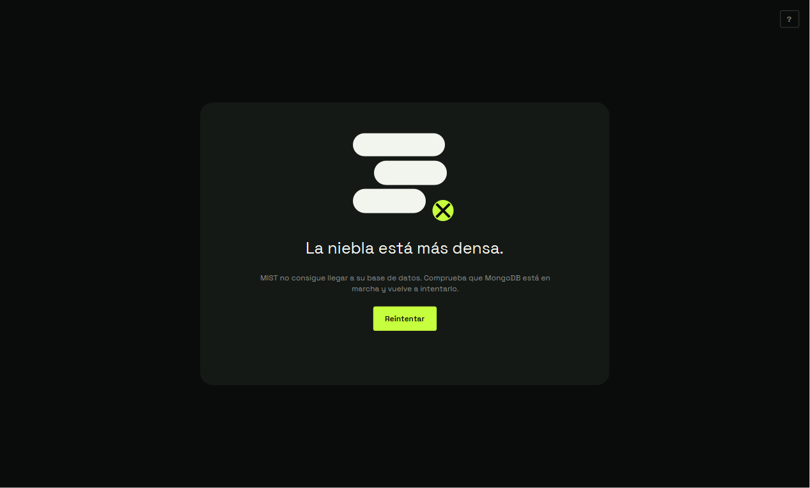

Comprueba que la base de datos está en marcha y pulsa **Reintentar**. Si sigue sin poder conectar, aparece *Sigue sin
haber conexión.* bajo el botón. El botón **?** de la esquina superior derecha abre la ayuda.

**Cuentas de demostración.** Una instalación nueva trae datos de ejemplo. Todas las cuentas de demostración usan la
contraseña `mist2026`:

| Cuenta | Correo |
| --- | --- |
| Jugador | `lucia@mist.com` (también `marc@mist.com` y `nora@mist.com`) |
| Desarrollador | `rockstarnorth@mist.com` |
| Administrador | `admin@mist.com` |

## 2. Entrar y crear una cuenta

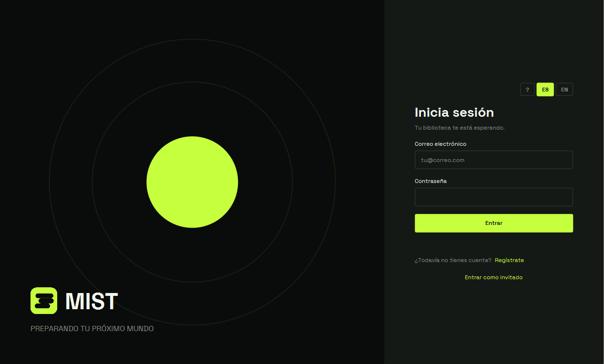

- Escribe tu **Correo electrónico** y tu **Contraseña** y pulsa **Entrar** (o Intro). Si alguno es incorrecto, MIST
  dice *El correo o la contraseña no son correctos.* Nunca dice cuál de los dos, para que nadie pueda averiguar qué
  cuentas existen.
- **ES** y **EN**, arriba, cambian el idioma al momento; el correo que escribiste se mantiene.
- **Entrar como invitado** abre la tienda sin cuenta. Los invitados pueden ver todos los juegos, pero tienen que
  iniciar sesión para comprar.
- **Regístrate** abre el formulario de registro.

### Crear una cuenta

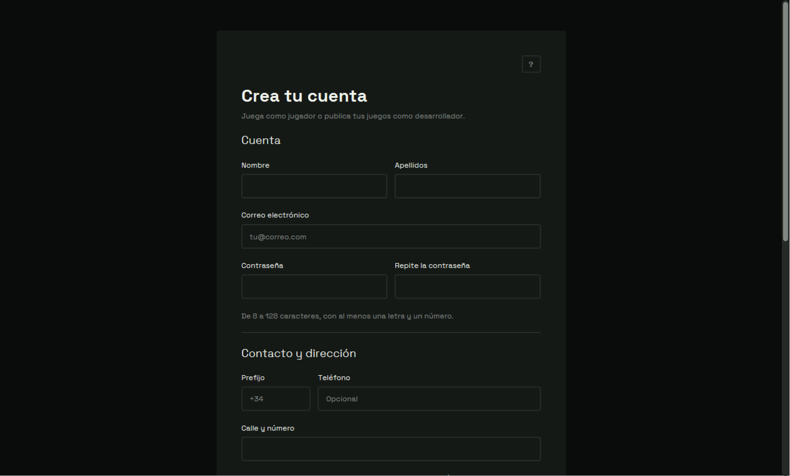

1. Rellena **Cuenta**: nombre, apellidos, correo y contraseña (dos veces). La contraseña necesita de 8 a 128
   caracteres, con al menos una letra y un número.
2. Rellena **Contacto y dirección**. El teléfono es opcional, pero si lo das, da el prefijo (por ejemplo `+34`) y el
   número. La calle, el código postal, la ciudad y el país son obligatorios.
3. Elige el **Tipo de cuenta**:
   - **Jugador**: un apodo (de 3 a 24 letras, números, puntos, guiones o guiones bajos) y la tarjeta con la que
     pagarás. MIST solo guarda la marca, el titular, los cuatro últimos dígitos y la caducidad; el número completo
     nunca se guarda.
   - **Desarrollador**: el nombre de tu estudio y el IBAN donde cobrarás tus ventas.
4. Pulsa **Crear cuenta**. MIST te lleva de vuelta al inicio de sesión con tu correo ya escrito.

Un campo con un problema se marca en rojo, y el mensaje bajo el formulario dice qué falla. Si el correo, el apodo o el
nombre del estudio ya están en uso, se marca ese campo. **Ya tengo cuenta** vuelve al inicio de sesión.

## 3. Moverse por MIST

Al entrar, la ventana mantiene una cabecera arriba:

- A la izquierda, las secciones de tu tipo de cuenta: **Tienda**, **Biblioteca**, **Deseados** y **Carrito** para los
  jugadores (el carrito muestra cuántos juegos tiene), **Estudio** para los desarrolladores y **Registro** para los
  administradores.
- A la derecha, el **menú de usuario** con tu nombre o tu foto: **Perfil**, **Idioma** (Español o English),
  **Tema** (Oscuro o Claro), **Ayuda**, **Registro de operaciones** (solo administradores) y **Cerrar sesión**. Tu
  idioma y tu tema se guardan en tu cuenta, así que vuelven la próxima vez que entres.

### Ayuda

**F1**, la opción **Ayuda** del menú de usuario o un botón **?** abren la ventana de ayuda en el tema de la pantalla
en la que estás. Elige otro tema en la lista de la izquierda. En un diálogo, **?** abre el tema de la pantalla que
está debajo, que explica el diálogo.

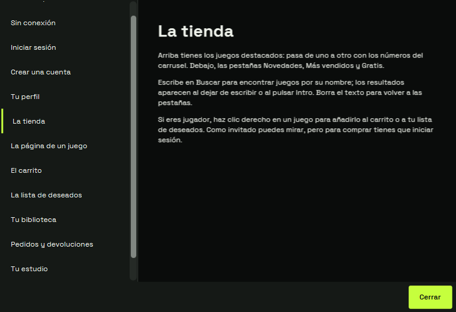

### Esperas y errores

Mientras MIST trabaja, el botón que pulsaste se desactiva un momento. Cuando algo falla, MIST muestra un mensaje:

- Un **aviso** significa que un valor incumple una regla, por ejemplo una tarjeta caducada. Corrígelo y vuelve a
  intentarlo.
- Un **error con Reintentar** significa que no se pudo llegar a la base de datos. Pulsa **Reintentar** cuando vuelva
  la conexión; lo que estabas haciendo se repite.

El [apartado 8](#8-mensajes-y-qué-hacer) recoge los mensajes.

## 4. Para jugadores

### La tienda

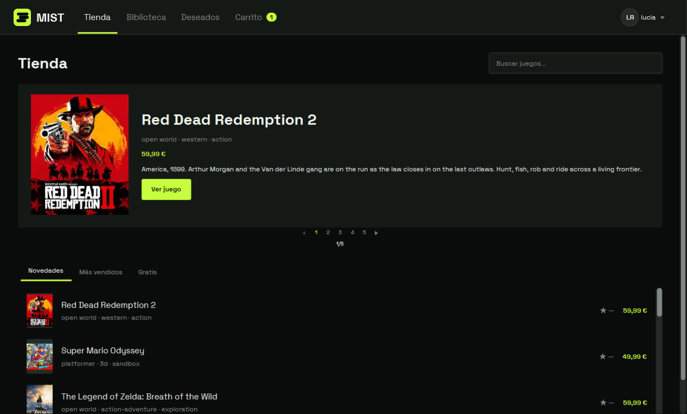

- El carrusel de **juegos destacados**, arriba: pasa de uno a otro con sus números o sus flechas, y pulsa **Ver
  juego**.
- Las pestañas **Novedades**, **Más vendidos** y **Gratis** listan juegos con su portada, sus etiquetas, su
  valoración y su precio.
- **Buscar juegos...** encuentra juegos por su nombre mientras escribes; borra el texto para volver a las pestañas.
- Haz doble clic en un juego, o pulsa Intro, para abrir su página. Con el botón derecho puedes abrirlo, añadirlo al
  carrito o añadirlo a la lista de deseados.

### La página de un juego

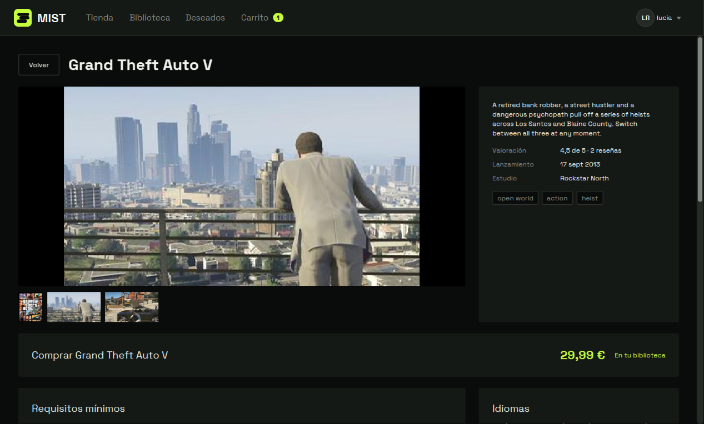

La página muestra las imágenes (pulsa una miniatura para verla en grande), la descripción, la valoración media, la
fecha de lanzamiento, el estudio, las etiquetas, los requisitos mínimos, los idiomas, la clasificación PEGI, los
logros y las reseñas de otros jugadores, de cinco en cinco.

En el recuadro de compra:

- **Añadir al carrito** y después **Ir al carrito** para pagar.
- **Añadir a deseados** para guardar el juego para más adelante.
- Si ya tienes el juego aparece **En tu biblioteca**, y **Escribir una reseña** si aún no lo has reseñado.

Haz clic derecho en un logro (**Copiar logro**) o en una reseña (**Copiar reseña**) para copiar su texto. **Volver**
regresa a la pantalla anterior.

### El carrito y el pago

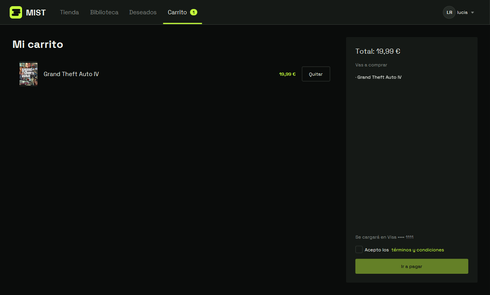

1. Revisa los juegos del carrito. **Quitar** saca uno; con el botón derecho puedes abrirlo o **Mover a la lista de
   deseados**.
2. El resumen de la derecha muestra el total y la tarjeta en la que se cargará.
3. Marca **Acepto los términos y condiciones** (el enlace los abre) y pulsa **Ir a pagar**.
4. MIST te pide confirmar el importe. Tras el pago, los juegos están en tu biblioteca y **Descargar el recibo** lo
   guarda en PDF.

Un carrito admite hasta 50 juegos. Si tu tarjeta ha caducado, cámbiala antes en tu [perfil](#7-tu-perfil).

### La lista de deseados

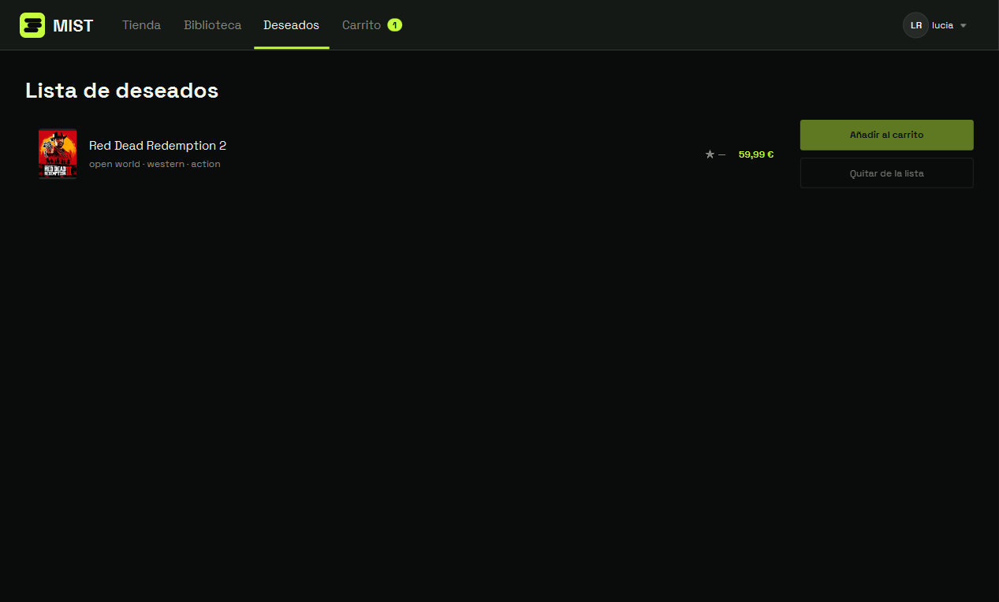

Selecciona un juego y pulsa **Añadir al carrito** para pasarlo al carrito, o **Quitar de la lista**. Haz doble clic
en un juego para abrir su página. Un juego que ya no está a la venta no se puede pasar al carrito.

### Tu biblioteca

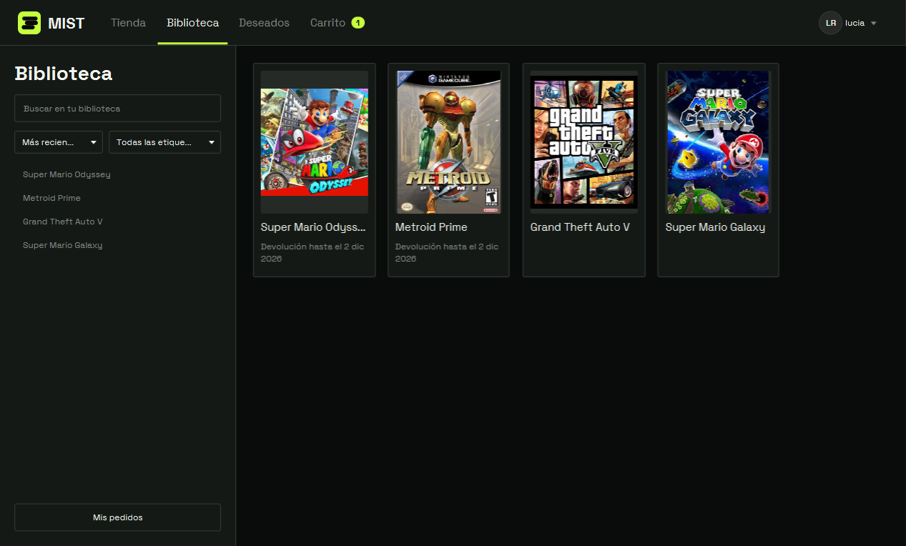

Todos los juegos que tienes, con sus nombres a la izquierda y sus portadas a la derecha.

- **Buscar en tu biblioteca** filtra por nombre; la lista de orden ordena por **Más recientes** o **Por nombre**; la de
  etiquetas muestra solo los juegos con esa etiqueta.
- Haz doble clic en un juego (o pulsa Intro) para abrir su página.
- Con el botón derecho puedes **Escribir una reseña** o **Devolver** un juego. Los juegos que aún puedes devolver
  muestran hasta qué día.
- **Mis pedidos** abre tus pedidos.

### Escribir una reseña

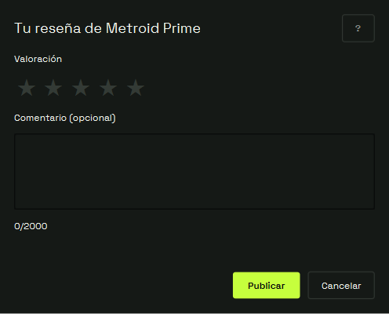

Elige de 1 a 5 estrellas, escribe un comentario si quieres (hasta 2000 caracteres; el contador muestra cuántos llevas)
y pulsa **Publicar**. Puedes reseñar una vez cada juego que tengas, y la reseña aparece después en la página del
juego.

### Pedidos y devoluciones

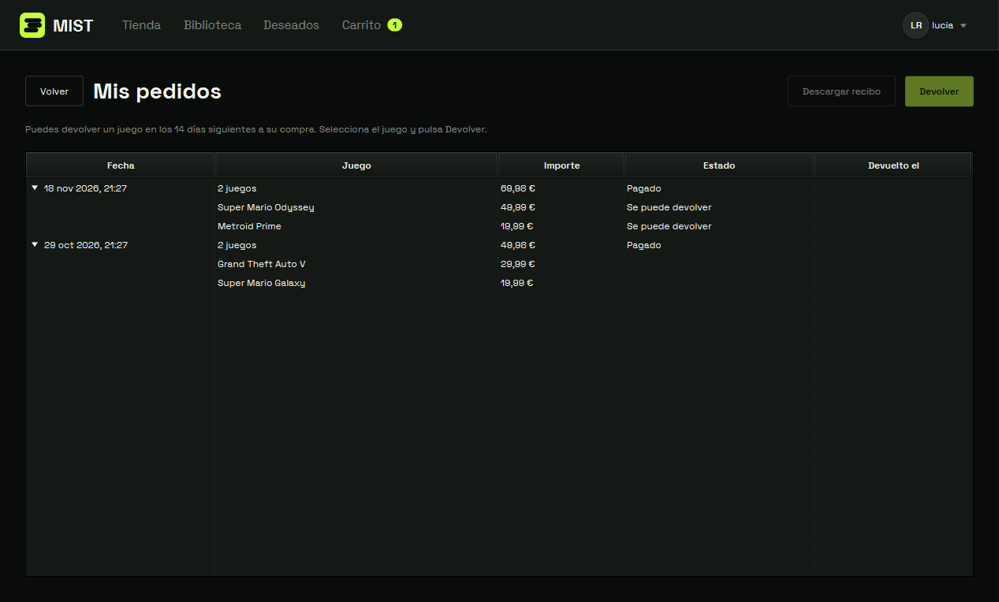

Cada pedido muestra su fecha, su importe y su estado, con los juegos comprados en él debajo.

- **Devolver** devuelve un juego en los 14 días siguientes a su compra: selecciona el juego, pulsa **Devolver** y
  confirma. El dinero vuelve a la tarjeta con la que se pagó el pedido y el juego sale de tu biblioteca. El pedido
  pasa a reembolsado en parte o del todo, con la fecha de cada devolución.
- **Descargar recibo** guarda en PDF el recibo del pedido seleccionado, donde tú elijas.

## 5. Para desarrolladores

### El panel de tu estudio

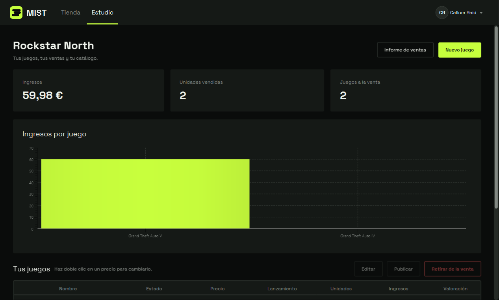

- Arriba, tus **Ingresos**, las **Unidades vendidas** y cuántos **Juegos a la venta** tienes, y un gráfico de los
  ingresos por juego.
- **Informe de ventas** guarda estas cifras en un PDF.
- **Tus juegos** lista todos tus juegos, borradores incluidos, con su estado, precio, lanzamiento, unidades, ingresos
  y valoración.
  - **Cambiar un precio en la tabla:** haz doble clic en el precio, escribe el nuevo y pulsa Intro. Si MIST no puede
    guardarlo, vuelve el precio anterior y un mensaje explica por qué.
  - **Editar** (o doble clic en el nombre) abre el juego en el editor.
  - **Publicar** pone a la venta un borrador; **Retirar de la venta** quita de la tienda un juego publicado. Los
    jugadores que lo tienen lo conservan. Con el botón derecho tienes las mismas acciones.

### Crear un juego

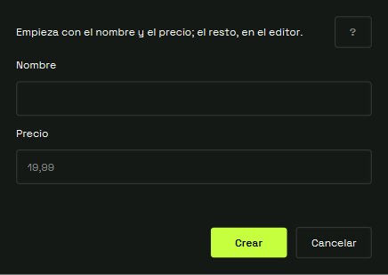

**Nuevo juego** solo pide un **Nombre** y un **Precio** (escribe `12,99`, `12.99` o `12,99 €`). **Crear** guarda el
juego como borrador y lo abre en el editor.

### El editor de juegos

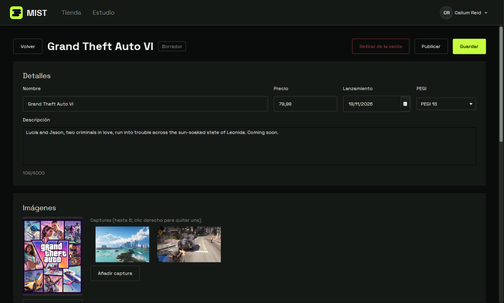

- **Detalles:** nombre, precio (de 0 a 999,99), fecha de lanzamiento, clasificación PEGI y descripción. Pulsa
  **Guardar** para conservar los cambios.
- **Imágenes:** **Cambiar portada** y **Añadir captura** suben una imagen PNG, JPEG o GIF de hasta 2 MB; un juego
  tiene hasta 8 capturas. Haz clic derecho en una captura para quitarla.
- **Requisitos mínimos:** rellena los cinco o ninguno.
- **Etiquetas:** escribe una y pulsa **Añadir** (hasta 10); el aspa de una etiqueta la quita. **Idiomas:** marca los
  que admite el juego.
- **Logros:** haz doble clic en un nombre o una descripción para cambiarlo y pulsa Intro. **Añadir logro** y
  **Quitar logro** (o el clic derecho en la tabla) añaden una fila o quitan la seleccionada. Se guardan con
  **Guardar**.
- **Publicar** pone a la venta el borrador. Un juego necesita portada, descripción, fecha de lanzamiento, PEGI y
  requisitos; lo que falte se marca en rojo. **Retirar de la venta** quita de la tienda un juego publicado.
- **Volver** regresa al panel.

## 6. Para administradores: el registro de operaciones

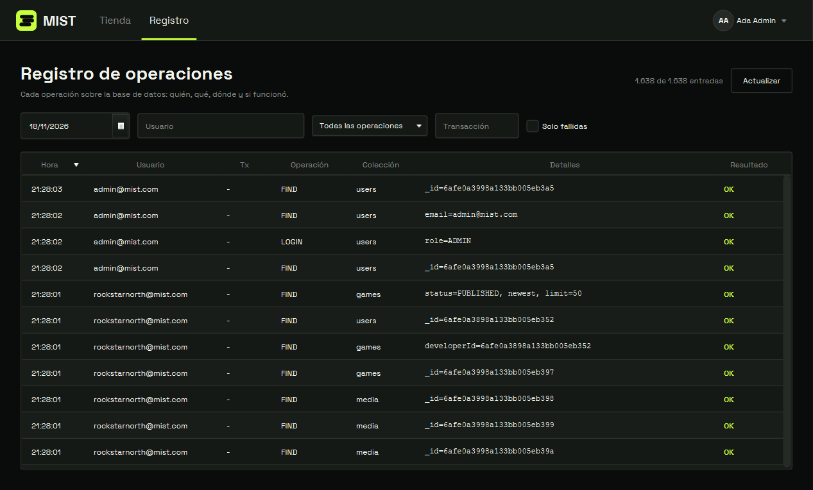

Cada operación que MIST hace sobre la base de datos se escribe en un archivo de registro. Esta pantalla permite leerlo
y filtrarlo.

- Cada línea muestra la **Hora**, el **Usuario** (el correo de la persona, o el correo que se está probando durante un
  inicio de sesión o un registro), el número **Tx** de la transacción a la que pertenece (`-` si ninguna), la
  **Operación**, la **Colección**, los **Detalles** y el **Resultado** (OK o FALLIDA). Pasa el ratón sobre los
  detalles para leerlos enteros.
- Elige el **Día** en el calendario; solo se pueden elegir días con registro.
- Filtra por **Usuario**, por operación, por número de **Transacción**, o marca **Solo fallidas**. El contador de
  arriba muestra cuántas líneas coinciden.
- Haz clic derecho en una línea para **Copiar la línea** o mostrar solo su usuario, su operación o su transacción.
  Una transacción empieza con `BEGIN` y termina con `COMMIT` (guardada) o `ROLLBACK` (deshecha): filtrar por su
  número muestra todas las operaciones que se guardaron o se deshicieron juntas.
- **Actualizar** vuelve a leer el registro sin cambiar de día.

## 7. Tu perfil

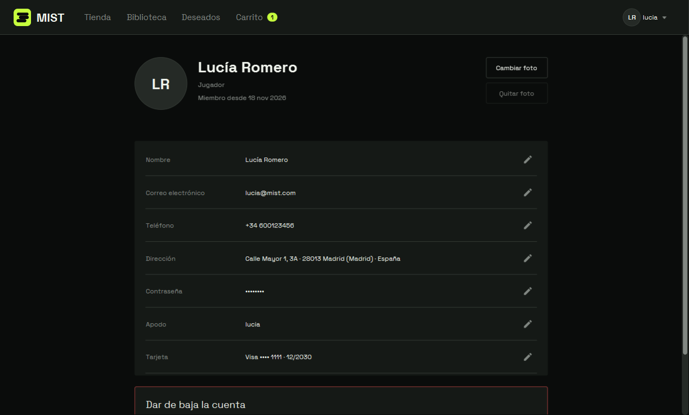

Ábrelo desde el menú de usuario (**Perfil**, o Ctrl+P).

- Cada fila muestra una parte de tu cuenta. Pulsa el lápiz para editarla en la misma fila y después **Guardar** o
  **Cancelar**. Solo se puede editar una fila a la vez.
- **Contraseña:** escribe la actual y después la nueva dos veces.
- **Tarjeta** (jugadores): escribe el número completo de la tarjeta nueva; solo se guardan sus cuatro últimos
  dígitos.
- **Nombre del estudio** y **Cuenta bancaria** (desarrolladores): el IBAN se muestra oculto en parte.
- **Cambiar foto** sube una imagen PNG, JPEG o GIF de hasta 2 MB; **Quitar foto** vuelve a tus iniciales.
- **Dar de baja** cierra tu cuenta tras pedirte confirmación. Ya no podrás entrar, y los juegos publicados de un
  desarrollador salen de la tienda.

## 8. Mensajes y qué hacer

| Mensaje | Qué significa y qué hacer |
| --- | --- |
| *El correo o la contraseña no son correctos.* | Revisa los dos y vuelve a intentarlo. |
| *Esta cuenta se ha dado de baja.* | La cuenta se cerró; vuelves al inicio de sesión. |
| *Usa de 8 a 128 caracteres, con al menos una letra y un número.* | Elige una contraseña más segura. |
| *Ya existe una cuenta con ese correo.* / *Ese apodo ya está en uso.* / *Ese nombre de estudio ya está en uso.* | Elige otro. |
| *Ya tienes este juego.* | Ya está en tu biblioteca. |
| *Este juego no está a la venta.* | El desarrollador lo retiró; no se puede comprar. |
| *La tarjeta está caducada.* | Cambia la tarjeta en tu perfil. |
| *Un pedido debe tener entre 1 y 50 juegos.* | Quita juegos del carrito. |
| *Este juego ya no se puede devolver.* | Han pasado los 14 días para devolverlo. |
| *Ya has valorado este juego.* | Cada juego se puede reseñar una vez. |
| *Añade portada, descripción, fecha de salida, PEGI y requisitos antes de publicar.* | Completa lo marcado en rojo en el editor. |
| *La imagen debe ocupar menos de 2 MB.* | Elige una imagen más pequeña. |
| *No se ha podido leer el archivo.* | El archivo se movió, se borró o está en uso; vuelve a elegirlo. |
| *No se ha podido guardar el informe. Elige otra carpeta o comprueba que el archivo no está abierto.* | Cierra el PDF si está abierto o guárdalo en otro sitio. |
| *No se ha podido acceder a la base de datos. Inténtalo de nuevo en un momento.* | Se perdió la conexión. Pulsa **Reintentar** cuando vuelva. |
| *La base de datos ha rechazado los datos porque un valor incumple una regla del modelo de datos.* | Un valor no se acepta; revisa los campos. |
| *Algo ha fallado. Inténtalo de nuevo; si sigue pasando, reinicia MIST.* | Un error inesperado; queda escrito en el registro de MIST para los desarrolladores. |

## 9. Atajos de teclado

| Teclas | Acción |
| --- | --- |
| F1 | Ayuda de la pantalla actual |
| Ctrl+P | Tu perfil |
| Ctrl+L | Registro de operaciones (administradores) |
| Ctrl+Mayús+Q | Cerrar sesión |
| Intro | Abrir el juego seleccionado en una lista; pulsar el botón principal del formulario |
| Supr | Quitar del carrito el juego seleccionado |
| Esc | Cancelar un diálogo |
