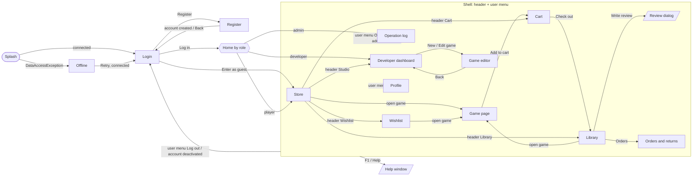

# MIST UI design

This document is the detailed design of MIST's desktop interface: how every screen looks (**aspect**) and what every
interaction does (**behavior**). The code follows it: each controller method carries a comment that cites the behavior
ID it implements (`// LOGIN-1.R2 ...`), and each screen's TestFX test exercises the same IDs.

How to read a behavior table:

- **ID**: `SCREEN-n`; its responses are `SCREEN-n.R1`, `R2`, ... `R1` is always the success path.
- **Trigger**: the control and event, written as `fxId.onAction → Controller#method`.
- **Checks**: what the UI validates before calling a service (see [C-3](#c-3-validation)).
- **Calls**: the service method, with its technical name and signature.
- **Responses**: what the user sees, per outcome. An exception is written as `Type(bundle.key)`.

Default control behavior (typing in a field, scrolling a list, opening a combo box) is not described.

## Contents

1. [Architecture of the UI layer](#architecture-of-the-ui-layer)
2. [Aspect: the style guide](#aspect-the-style-guide)
3. [Common behavior](#common-behavior)
4. [Navigation](#navigation)
5. [Screens](#screens)

## Architecture of the UI layer

| Object | Package | Role |
|---|---|---|
| `MistApp` | `com.mist` | JavaFX `Application`. Builds the `UiContext` with the production `Backend` (`MistBackend`, which opens `MistContext`) and shows the splash. Closes the backend in `stop()`. |
| `UiContext` | `com.mist.ui` | Holds what every controller needs: `services()`, `session()`, `navigator()`, `files()`, `tasks()`, `errors()`, `images()`. `connect()` asks the `Backend` for the services. |
| `Backend` | `com.mist.ui` | `AppServices connect() throws DataAccessException` and `close()`. The UI never sees `MistContext` or a DAO. |
| `AppServices` | `com.mist.ui` | Record of the services: `auth`, `users`, `store`, `library`, `reviews`, `publishing`, `media`, `logs`. |
| `Navigator` | `com.mist.ui` | `show(View)`, `show(View, Object)`, `back()`, `reload()`, `home()`. Swaps the scene root for full screens and the shell's content for the others. |
| `SceneRouter` | `com.mist.ui` | Loads an FXML file with the current bundle, TailwindFX processing and a controller factory that passes the `UiContext` to each controller's constructor. |
| `View` | `com.mist.ui` | One constant per screen: its FXML file, whether it lives inside the shell, and its help topic. |
| `UserSession` | `com.mist.ui` | The logged-in `User` (an observable property), or a guest. `start(User)`, `startGuest()`, `update(User)`, `end()`. |
| `NavigationAware` | `com.mist.ui` | Implemented by controllers that need data when shown: `onNavigatedTo(Object parameter)`. |
| `UiTasks` | `com.mist.ui.support` | Runs service calls off the JavaFX thread as a `javafx.concurrent.Task` ([C-1](#c-1-background-work)). |
| `ErrorReporter` | `com.mist.ui.support` | Turns exceptions into the reactions of [C-2](#c-2-error-handling). |
| `FormValidator` | `com.mist.ui.support` | Field checks and error marks ([C-3](#c-3-validation)). |
| `Dialogs` | `com.mist.ui.support` | Themed, non-blocking alerts and confirmations with bundle texts. |
| `Formats` | `com.mist.ui.support` | Locale-aware money (EUR), dates and enum labels. |
| `Images` | `com.mist.ui.support` | Loads covers, screenshots and avatars through `MediaService#image(ObjectId)` in the background, with a cache. |
| `FilePicker` | `com.mist.ui` | Wraps `FileChooser` (open an image, save a PDF), so tests can stub the native dialogs. |
| `HelpController` | `com.mist.ui.controller` | The help window's content ([C-6](#c-6-help)); `Navigator#showHelp()` opens the window. |
| `DemoData`, `LogService` | `com.mist.service` | The demo content seeded into an empty database, and the admins' reader of the operation log. |
| Controllers | `com.mist.ui.controller` | One per FXML view. They call services only through `UiTasks` and never touch DAOs (enforced by `LayerRulesTest`). |

FXML files live in `src/main/resources/com/mist/ui/view/`, one per screen, and keep `fx:controller` so Scene Builder
opens them. Every text comes from `i18n/messages_{es,en}.properties` through `%key` in FXML or `I18n.bundle()` in code.

## Aspect: the style guide

### Palette

Colors come only from the brand tokens in `mist-theme.css`; the light theme (`mist-theme-light.css`, appended after it)
redefines the same tokens, so no view names a color.

| Token | Dark (default) | Light | Used for |
|---|---|---|---|
| `-mist-void` | `#0A0C0B` | `#E4E8E0` | Window background |
| `-mist-surface` | `#151916` | `#F2F5EE` | Cards, fields, menus, table rows |
| `-mist-fog` | `#F2F5EE` | `#0A0C0B` | Main text |
| `-mist-ash` | `#818782` | `#686E69` | Secondary text, placeholders, captions |
| `-mist-acid` | `#C6FF3D` | `#C6FF3D` | Primary buttons, selection accent, progress, "OK" outcome |
| `-mist-border` | `#343A35` | `#C9CEC5` | Field and card borders, separators |
| `-mist-track` | `#252A26` | `#D5DAD1` | Progress track, disabled fills |
| `-mist-danger` | `#FF5C5C` | `#C62828` | Errors, "FAILED" outcome, destructive buttons |

Text on acid is always `-mist-void` in both themes (acid stays the same), so the primary button keeps its contrast.

### Typography

Space Grotesk (Regular, Medium, Bold), loaded by `Styles` from `com/mist/ui/fonts`.

| Role | Size | Weight | Class |
|---|---|---|---|
| Wordmark (splash) | 104 px | Bold | `mist-wordmark` |
| Screen title | 28 px | Bold | `mist-title` |
| Section title | 18 px | Medium | `mist-subtitle` |
| Body, fields, buttons | 14 px | Regular | default |
| Caption, hints, table meta | 12 px | Regular | `mist-caption` |

### Shape, spacing and layout

- Corners are 3 px everywhere (`mist-rounded`); avatars are circles.
- Spacing follows a 4 px grid through TailwindFX utilities (`p-6` = 24 px, `gap-[16px]`).
- The window is at least 1024 x 640; screens grow with it. Forms are at most 560 px wide and centered.
- Selected list rows and the active navigation link get a 3 px acid left border (`mist-accent-left`).

### Controls

| Control | Aspect |
|---|---|
| Primary button | Acid fill, void text, bold (`.button`). One per screen, the default button of its form. |
| Secondary button | Transparent, fog text, border (`mist-button-secondary`). |
| Danger button | Danger border and text (`mist-button-danger`); used only for irreversible actions. |
| Text field, password field, combo box, date picker | Surface fill, border, ash prompt text. Focus: acid border. |
| Invalid field | Danger border (`:error` pseudo-class) and a tooltip with the message. |
| Form message | Label under the form; danger text for errors (`mist-message-error`), acid for success (`mist-message-ok`). |
| Table | Surface rows, ash header text, acid left border on the selected row. |
| Dialog | Surface background, fog text, buttons with bundle texts (never JavaFX's own "OK"/"Cancel"). |
| Busy state | The triggering control is disabled and the cursor shows "wait" while the task runs. |

### States

- **Empty**: a centered caption explaining why nothing is listed (`ListView`/`TableView` placeholder).
- **Offline**: the brand's offline art, rebuilt in FXML from `docs/brand/mist-offline.svg`, with bundle texts.
- **Error**: a dialog for errors not tied to a field; an inline mark for field errors.

## Common behavior

### C-1 Background work

Every service call goes through `UiTasks#run(Node busy, Work<T> work, Consumer<T> onSuccess)` (or the overload with
an `onFailure` handler). The work runs on a worker thread; `busy` is disabled until it ends; `onSuccess` runs on the
JavaFX thread. A failure goes to `ErrorReporter#report(Window owner, Throwable error, Runnable retry)` unless the
caller handles it.

### C-2 Error handling

`ErrorReporter` reacts to each exception the services declare:

| Exception (bundle key) | Reaction |
|---|---|
| `ValidationException(model.*, service.*)` | Shown inline on the bound field when the screen has a form ([C-3](#c-3-validation)); otherwise a warning dialog with the message. |
| `DuplicateEntityException(service.user.*Taken, service.review.alreadyExists, dao.duplicate)` | Same as a validation error. Checked before `DataAccessException`, which it extends. |
| `NotFoundException(service.*.notFound)` | Warning dialog with the message. |
| `UnauthorizedException(service.account.deactivated)` | The session ends; Login opens with the message. |
| `UnauthorizedException(other keys)` | Warning dialog with the message; the session stays. |
| `DataAccessException(dao.failure, service.log.unreadable)` | Error dialog with the message and a **Retry** button that runs the same work again. |
| `IOException` (a file the user picked) | Error dialog with `error.fileUnreadable`. |
| Any other `Throwable` | Logged with its stack trace to `mist-app.log`; error dialog with `error.unexpected`. Unhandled exceptions on the JavaFX thread reach the same handler through `Thread.setDefaultUncaughtExceptionHandler`. |

Every reaction is also written to `mist-app.log` by the logger `com.mist.ui` (screen, action, key); the database log
(`mist-db.log`) is written by the data layer.

### C-3 Validation

`FormValidator` checks fields before the service call, so obvious mistakes never reach the database:

- `required(field)`: not blank → `validation.required`.
- `email(field)`: the model's email shape → `model.user.email`.
- `maxLength(field, max, key)`: the model's limits (`User.MAX_FIRST_NAME_LENGTH`, ...).
- `pattern(field, regex, key)`: phone, postal code, nickname, IBAN, card number.
- `sameText(repeat, original)`: → `validation.passwordMismatch`.
- `password(field)`: `AuthService.MIN_PASSWORD_LENGTH`..`MAX_PASSWORD_LENGTH` with a letter and a digit →
  `service.auth.weakPassword`.

A failing field gets the `:error` pseudo-class and a tooltip; the first one is focused; the form message shows the
first error. `FormValidator#bind(String key, Control field)` maps a service key to its field, so a
`ValidationException` or `DuplicateEntityException` from the service is marked on the right field too.
Editing a marked field clears its mark.

### C-4 Language

The language can change on Login (toggle) and in the user menu. `I18n#use(Locale)` switches the bundle and
`Navigator#reload()` rebuilds the screen (the shell and the current view) in place. For a logged-in user the choice is
saved with `UserService#changePreferences(ObjectId, Language, Theme)`, and `LoginController` applies the saved
`Preferences` after login.

### C-5 Theme

Dark (default) or light, chosen in the user menu. `Styles#applyTheme(Scene, Theme)` adds or removes
`mist-theme-light.css` after the dark theme; the choice is saved like the language.

### C-6 Help

**F1**, the user menu's Help item, or a screen's **?** button call `Navigator#showHelp()`, which opens the help
window (non-modal, `help.fxml` with `HelpController`). It lists one topic
per screen (`help.<topic>.title`, `help.<topic>.body`) and opens on the topic of the current screen.

### C-7 Keyboard

Each form has a default button (Enter) and a cancel button (Esc) where it makes sense. Menu items have accelerators,
listed in the shell section. Tab order follows the visual order.

## Navigation



### Screens and use cases

| Screen | `View` | FXML | Controller | Roles | Use cases |
|---|---|---|---|---|---|
| Splash | `SPLASH` | `splash.fxml` | `SplashController` | all | UC-00 Start MIST and connect |
| Offline | `OFFLINE` | `offline.fxml` | `OfflineController` | all | UC-00 Retry the connection |
| Login | `LOGIN` | `login.fxml` | `LoginController` | guest | UC-02 Log in, UC-13 Change language, UC-22 Browse as guest |
| Register | `REGISTER` | `register.fxml` | `RegisterController` | guest | UC-01 Register as player or developer |
| Shell | `SHELL` | `shell.fxml` | `ShellController` | logged in, guest | UC-03 Log out, UC-13 Change language and theme, UC-20 Get help |
| Profile | `PROFILE` | `profile.fxml` | `ProfileController` | player, developer, admin | UC-12 Edit profile, UC-14 Deactivate account |
| Operation log | `ADMIN_LOG` | `admin-log.fxml` | `AdminLogController` | admin | UC-19 View and filter the database log |
| Help | (window) | `help.fxml` | `HelpController` | all | UC-20 Get help |
| Store | `STORE` | `store.fxml` | `StoreController` | guest, player, developer | UC-04 Browse and search the catalog |
| Game page | `GAME` | `game.fxml` | `GameController` | guest, player, developer | UC-05 View a game, UC-06 Add to cart, UC-08 Add to wishlist |
| Cart | `CART` | `cart.fxml` | `CartController` | player | UC-06 Manage the cart, UC-07 Check out, UC-21 Download receipt |
| Wishlist | `WISHLIST` | `wishlist.fxml` | `WishlistController` | player | UC-08 Manage the wishlist |
| Library | `LIBRARY` | `library.fxml` | `LibraryController` | player | UC-09 View the library, UC-11 Rate a game |
| Orders | `ORDERS` | `orders.fxml` | `OrdersController` | player | UC-10 Return a game, UC-21 Download receipt |
| Developer dashboard | `STUDIO` | `studio.fxml` | `StudioController` | developer | UC-18 View sales and export the report, UC-17 Delist a game |
| Game editor | `GAME_EDITOR` | `game-editor.fxml` | `GameEditorController` | developer | UC-15 Create and edit a game, UC-16 Publish a game |

The store, game, cart, wishlist, library, orders, dashboard and editor screens are detailed in their own sections,
added with their implementation.

## Screens

### Splash

**Aspect.** The brand splash, rebuilt in FXML from `docs/brand/mist-splash.svg` at 1280 x 720: rings and an acid orb
on the right, the MIST mark and wordmark (`wordmark`), the tagline (`tagline`, `%splash.tagline`) and a thin acid
progress bar (`progress`), indeterminate while connecting.

| ID | Trigger | Checks | Calls | Responses |
|---|---|---|---|---|
| SPLASH-1 | `SplashController#onNavigatedTo` (the splash is shown) | none | `UiContext#connect()` → `Backend#connect()` (`MistContext.open(AppConfig)`; it applies `SchemaSetup` and seeds the demo data into an empty database) | **R1** Connected: `Navigator#show(LOGIN)`. **R2** `DataAccessException(dao.failure)`: `Navigator#show(OFFLINE)`. |

### Offline

**Aspect.** Void background; centered card in surface color with the MIST mark and a crossed acid dot (from
`mist-offline.svg`), the title `offlineTitle` (`%offline.title`), the message `offlineMessage` (`%offline.message`),
the primary button `retryButton` (`%offline.retry`) and a caption `retryStatus` (hidden until a retry fails).

| ID | Trigger | Checks | Calls | Responses |
|---|---|---|---|---|
| OFFLINE-1 | `retryButton.onAction → OfflineController#onRetry` | none | `UiContext#connect()` | **R1** Connected: `Navigator#show(LOGIN)`. **R2** `DataAccessException`: `retryStatus` shows `offline.stillOffline`; the button is enabled again. |

### Login

**Aspect.**

```
+----------------------------------+-----------------------------+
|  [mark] MIST                     |                 [ES][EN]    |
|                                  |  Log in                     |
|  PREPARING YOUR NEXT WORLD       |  Email     [______________] |
|  (brand panel, void, rings)      |  Password  [______________] |
|                                  |  [   Log in   ] (primary)   |
|                                  |  formMessage                |
|                                  |  No account? Register       |
+----------------------------------+-----------------------------+
```

| fx:id | Control | Format / validation |
|---|---|---|
| `esToggle`, `enToggle` | `ToggleButton` in `languageGroup` | Selected = current language |
| `emailField` | `TextField` | Required; email shape |
| `passwordField` | `PasswordField` | Required |
| `loginButton` | `Button` (default) | Disabled while the login runs |
| `formMessage` | `Label` | Error or notice text |
| `registerLink` | `Hyperlink` | |
| `guestLink` | `Hyperlink` | |

| ID | Trigger | Checks | Calls | Responses |
|---|---|---|---|---|
| LOGIN-1 | `loginButton.onAction` (or Enter) `→ LoginController#onLogin` | `required(emailField)`, `email(emailField)`, `required(passwordField)` | `AuthService#login(String email, char[] password)` | **R1** `UserSession#start(User)`; the user's `Preferences` are applied (C-4, C-5); `Navigator#home()`. **R2** `UnauthorizedException(service.auth.badCredentials)`: `formMessage` shows it, the password is cleared and focused. **R3** `UnauthorizedException(service.account.deactivated)`: `formMessage` shows it. **R4** `DataAccessException`: C-2 retry dialog. |
| LOGIN-2 | `registerLink.onAction → LoginController#onRegister` | none | none | `Navigator#show(REGISTER)` |
| LOGIN-3 | `esToggle`/`enToggle` selected `→ LoginController#onLanguage` | none | `I18n#use(Locale)` | The screen reloads in the chosen language and keeps the typed email (C-4). |
| LOGIN-5 | `guestLink.onAction → LoginController#onGuest` | none | none | `UserSession#startGuest()`; `Navigator#home()` opens the store. A guest can browse; buying asks to log in. |
| LOGIN-4 | `LoginController#onNavigatedTo(LoginNotice)` | none | none | `emailField` is filled and `formMessage` shows the notice (`register.done`, `profile.deactivated`, `service.account.deactivated`). |

### Register

**Aspect.** A centered, scrollable form (max 560 px) with three groups: **Account** (first name, last name, email,
password, repeat password), **Contact** (phone country code and number, street, details, postal code, city, province,
country), and **Account type** (radio buttons Player / Developer). Choosing Player reveals the **Player** group
(nickname, card holder, card number, expiry month and year); choosing Developer reveals the **Developer** group
(studio name, IBAN). The primary button `registerButton` and the link `backLink` close the form.

| fx:id | Control | Format / validation |
|---|---|---|
| `firstNameField`, `lastNameField` | `TextField` | Required; max `User.MAX_FIRST_NAME_LENGTH` / `MAX_LAST_NAME_LENGTH` |
| `emailField` | `TextField` | Required; email shape |
| `passwordField`, `repeatField` | `PasswordField` | Password policy; same text |
| `phoneCodeField`, `phoneNumberField` | `TextField` | Optional pair: `+` and 1-3 digits; 4-14 digits |
| `streetField`, `detailsField`, `postalCodeField`, `cityField`, `provinceField` | `TextField` | Street, postal code and city required |
| `countryBox` | `ComboBox<String>` | ISO country codes shown with their localized names; required |
| `playerRadio`, `developerRadio` | `RadioButton` in `roleGroup` | Player selected by default |
| `nicknameField` | `TextField` | 3-24 letters, digits, `.`, `_`, `-` |
| `cardHolderField`, `cardNumberField` | `TextField` | Required; 12-19 digits (spaces allowed) |
| `expiryMonthBox`, `expiryYearBox` | `ComboBox<Integer>` | 1-12; this year to +15 |
| `studioNameField` | `TextField` | Required; max `Developer.MAX_STUDIO_NAME_LENGTH` |
| `bankAccountField` | `TextField` | IBAN (spaces allowed) |
| `formMessage` | `Label` | |

| ID | Trigger | Checks | Calls | Responses |
|---|---|---|---|---|
| REGISTER-1 | `roleGroup.selectedToggle` changes `→ RegisterController#onRoleChanged` | none | none | Shows the Player or the Developer group; the other is hidden and not validated. |
| REGISTER-2 | `registerButton.onAction → RegisterController#onRegister` | All field checks above for the visible groups | `AuthService#registerPlayer(PlayerSignUp)` or `AuthService#registerDeveloper(DeveloperSignUp)` | **R1** `Navigator#show(LOGIN, LoginNotice(email, register.done))`. **R2** `DuplicateEntityException(service.user.emailTaken / nicknameTaken / studioNameTaken)`: marked on the email, nickname or studio field. **R3** `ValidationException(model.*, service.auth.weakPassword)`: marked on its bound field. **R4** `DataAccessException`: C-2 retry dialog. |
| REGISTER-3 | `backLink.onAction → RegisterController#onBack` | none | none | `Navigator#show(LOGIN)` |

### Shell

**Aspect.** A `BorderPane`: the top bar (64 px, surface) holds the MIST mark and wordmark, the navigation links
(`header.fxml`, included as `header`) and the user menu on the right; the center (`content`) holds the current
screen.

The user menu `userMenu` (`MenuButton`) shows the avatar (circle) and the user's name, or "Guest". Its items:

| fx:id | Item | Accelerator | Visible for |
|---|---|---|---|
| `profileItem` | Profile | Ctrl+P | logged in |
| `languageMenu` → `spanishItem`, `englishItem` | Language (radio items) | | all |
| `themeMenu` → `darkItem`, `lightItem` | Theme (radio items) | | all |
| `helpItem` | Help | F1 | all |
| `logItem` | Operation log | Ctrl+L | admin |
| `logoutItem` | Log out; for a guest, Log in | Ctrl+Shift+Q | all |

| ID | Trigger | Checks | Calls | Responses |
|---|---|---|---|---|
| SHELL-1 | `ShellController#onNavigatedTo` | none | `Images#load(ObjectId, double, double, Consumer<Image>)` | The menu shows the user's name and avatar, and only the items of their role. |
| SHELL-2 | `profileItem.onAction → ShellController#onProfile` | none | none | `Navigator#show(PROFILE)` |
| SHELL-3 | `spanishItem`/`englishItem.onAction → ShellController#onLanguage` | none | `I18n#use(Locale)`; logged in: `UserService#changePreferences(ObjectId, Language, Theme)` | **R1** The screen reloads in the new language; the preference is saved and `UserSession#update(User)`. **R2** `DataAccessException`: the language still changes for this session; C-2 dialog. |
| SHELL-4 | `darkItem`/`lightItem.onAction → ShellController#onTheme` | none | `Styles#applyTheme(Scene, Theme)`; logged in: `UserService#changePreferences(...)` | **R1** The theme changes at once and is saved. **R2** as SHELL-3.R2. |
| SHELL-5 | `helpItem.onAction` or F1 `→ ShellController#onHelp` | none | `Navigator#showHelp()` | The help window opens on the current screen's topic. |
| SHELL-6 | `logItem.onAction → ShellController#onOperationLog` | admin | none | `Navigator#show(ADMIN_LOG)` |
| SHELL-7 | `logoutItem.onAction → ShellController#onLogout` | none | `AuthService#logout()` | `UserSession#end()`; `Navigator#show(LOGIN)`. A guest goes to Login the same way. |

### Profile

**Aspect.** A centered column (max 720 px). At the top: the avatar (96 px circle, `avatarCircle`), the full name, the
role and "member since" date, and the buttons `changeAvatarButton` and `removeAvatarButton`. Below, one row per
editable item, each with a label, the current value and a pencil button; the pencil opens the row's editor in place
(the fields, **Save** and **Cancel**). Only one row is open at a time. At the bottom, the **Deactivate account** danger
button.

| Row | View fx:id | Editor fields | Roles |
|---|---|---|---|
| Name | `nameValue`, `nameEdit` | `firstNameField`, `lastNameField` | all |
| Email | `emailValue`, `emailEdit` | `emailField` | all |
| Phone | `phoneValue`, `phoneEdit` | `phoneCodeField`, `phoneNumberField` | all |
| Address | `addressValue`, `addressEdit` | `streetField`, `detailsField`, `postalCodeField`, `cityField`, `provinceField`, `countryBox` | all |
| Password | `passwordValue` (dots), `passwordEdit` | `currentPasswordField`, `newPasswordField`, `repeatPasswordField` | all |
| Nickname | `nicknameValue`, `nicknameEdit` | `nicknameField` | player |
| Card | `cardValue` (brand, `•••• 1234`, expiry), `cardEdit` | `cardHolderField`, `cardNumberField`, `expiryMonthBox`, `expiryYearBox` | player |
| Studio | `studioValue`, `studioEdit` | `studioNameField` | developer |
| Bank account | `bankValue`, `bankEdit` | `bankAccountField` | developer |

Each editor has its own Save button (`<row>Save`) and Cancel button (`<row>Cancel`), and `formMessage` shows the result.

| ID | Trigger | Checks | Calls | Responses |
|---|---|---|---|---|
| PROFILE-1 | `ProfileController#onNavigatedTo` | none | `UserService#get(ObjectId)` | **R1** The rows show the stored values; the rows of the other roles are hidden. **R2** errors: C-2. |
| PROFILE-2 | `<row>Edit.onAction → ProfileController#onEdit` | none | none | Opens that row's editor with the current values; closes any other open editor. |
| PROFILE-3 | `<row>Cancel.onAction → ProfileController#onCancel` | none | none | Closes the editor and discards the changes. |
| PROFILE-4 | `nameSave`, `emailSave`, `phoneSave`, `addressSave` `→ ProfileController#onSaveProfile` | The row's field checks (as in Register) | `UserService#updateProfile(ObjectId, ProfileForm)` (the other values are sent unchanged) | **R1** `UserSession#update(User)`; the row closes and shows the new value; `formMessage` shows `profile.saved`. **R2** `DuplicateEntityException(service.user.emailTaken)`: marked on `emailField`. **R3** `ValidationException(model.*)`: marked on the bound field. |
| PROFILE-5 | `nicknameSave → ProfileController#onSaveNickname` | Nickname pattern | `UserService#changeNickname(ObjectId, String)` | As PROFILE-4 (`service.user.nicknameTaken` on `nicknameField`). |
| PROFILE-6 | `cardSave → ProfileController#onSaveCard` | Card checks | `UserService#changeCard(ObjectId, CardForm)` | As PROFILE-4 (`model.card.*` on the card fields). |
| PROFILE-7 | `studioSave → ProfileController#onSaveStudio` | Required, max length | `UserService#changeStudioName(ObjectId, String)` | As PROFILE-4 (`service.user.studioNameTaken`). |
| PROFILE-8 | `bankSave → ProfileController#onSaveBank` | IBAN pattern | `UserService#changeBankAccount(ObjectId, String)` | As PROFILE-4. |
| PROFILE-9 | `passwordSave → ProfileController#onSavePassword` | `required(currentPasswordField)`, `password(newPasswordField)`, `sameText(repeatPasswordField, newPasswordField)` | `AuthService#changePassword(ObjectId, char[], char[])` | **R1** The editor closes; `profile.passwordChanged`. **R2** `UnauthorizedException(service.auth.wrongPassword)`: marked on `currentPasswordField` (the session stays). **R3** `ValidationException(service.auth.weakPassword)`: marked on `newPasswordField`. |
| PROFILE-10 | `changeAvatarButton.onAction → ProfileController#onChangeAvatar` | The chosen file can be read | `FilePicker#openImage(Window)`, then `UserService#changeAvatar(ObjectId, ImageUpload)` | **R1** The new avatar shows here and in the user menu. **R2** `ValidationException(model.media.size / model.media.type)`: warning dialog. **R3** `IOException` reading the file: error dialog `error.fileUnreadable`. **R4** Cancelled chooser: nothing happens. |
| PROFILE-11 | `removeAvatarButton.onAction → ProfileController#onRemoveAvatar` | An avatar exists | Confirmation `profile.removeAvatar.confirm`, then `UserService#removeAvatar(ObjectId)` | **R1** The placeholder avatar shows. |
| PROFILE-12 | `deactivateButton.onAction → ProfileController#onDeactivate` | none | Confirmation `profile.deactivate.confirm` (a developer is told their games leave the store), then `UserService#deactivate(ObjectId)` and `AuthService#logout()` | **R1** `UserSession#end()`; `Navigator#show(LOGIN, LoginNotice(null, profile.deactivated))`. **R2** errors: C-2. |

### Operation log (admin)

**Aspect.** A filter bar over a full-height table.

```
Day [2026-11-18 v]  User [________]  Operation [All v]  [x] Failed only   [Refresh]   312 of 1,204 entries
+---------------------+------------------+-----------+-------------+-------------------------------+---------+
| Time                | User             | Operation | Collection  | Details                       | Outcome |
+---------------------+------------------+-----------+-------------+-------------------------------+---------+
| 18:41:07            | lucia@mist.local | INSERT    | orders      | id=6721f3...                  | OK      |
| 18:42:13            | marc@mist.local  | ROLLBACK  | -           | DuplicateKey...               | FAILED  |
```

| fx:id | Control | Format |
|---|---|---|
| `dayPicker` | `DatePicker` | Only days with a log file can be picked |
| `userFilter` | `TextField` | Contains, case-insensitive |
| `operationFilter` | `ComboBox<String>` | "All" plus the day's operations |
| `failedOnly` | `CheckBox` | |
| `refreshButton` | `Button` (secondary) | |
| `countLabel` | `Label` | `log.count` = "{0} of {1} entries" |
| `logTable` | `TableView<LogEntry>` | Sorted by time, newest first |
| `timeColumn` | `TableColumn<LogEntry, LocalDateTime>` | `HH:mm:ss` |
| `userColumn`, `operationColumn`, `collectionColumn` | `TableColumn<LogEntry, String>` | |
| `detailsColumn` | `TableColumn<LogEntry, String>` | Ellipsis, full text in a tooltip |
| `outcomeColumn` | `TableColumn<LogEntry, Boolean>` | "OK" in acid, "FAILED" in danger |

Row context menu: **Copy line** (`copyItem`), **Show only this user** (`filterUserItem`), **Show only this
operation** (`filterOperationItem`).

| ID | Trigger | Checks | Calls | Responses |
|---|---|---|---|---|
| LOG-1 | `AdminLogController#onNavigatedTo` | admin | `LogService#days(ObjectId)` | **R1** `dayPicker` enables only those days and selects the newest, which runs LOG-2. **R2** No log yet: the table placeholder shows `log.empty`. **R3** `UnauthorizedException(service.user.notAdmin)`: C-2. |
| LOG-2 | `dayPicker.value` changes `→ AdminLogController#onDayChanged` | none | `LogService#entries(ObjectId, LocalDate)` | **R1** The table lists the day's entries; the filters apply. **R2** `DataAccessException(service.log.unreadable)`: C-2 retry dialog; the table is emptied. |
| LOG-3 | `userFilter.text`, `operationFilter.value`, `failedOnly.selected` change `→ AdminLogController#applyFilters` | none | none (`FilteredList#setPredicate`) | The table and `countLabel` update at once. |
| LOG-4 | `refreshButton.onAction → AdminLogController#onRefresh` | none | `LogService#days`, `LogService#entries` | As LOG-1 and LOG-2, keeping the chosen day. |
| LOG-5 | `copyItem`, `filterUserItem`, `filterOperationItem` `.onAction` | A row is selected | `Clipboard#setContent` | Copies the row as a log line, or fills the matching filter. |

### Header

**Aspect.** Text links in the top bar, styled as tabs: the link of the current screen has the acid underline. The
cart link shows a badge with the number of games in the cart.

| fx:id | Control | Visible for |
|---|---|---|
| `storeLink` | `ToggleButton` in `links` | all |
| `wishlistLink` | `ToggleButton` in `links` | player |
| `libraryLink` | `ToggleButton` in `links` | player |
| `cartLink` | `ToggleButton` in `links`, with `cartBadge` (`Label`) as graphic | player |
| `studioLink` | `ToggleButton` in `links` | developer |
| `logLink` | `ToggleButton` in `links` | admin |

| ID | Trigger | Checks | Calls | Responses |
|---|---|---|---|---|
| HEADER-1 | `HeaderController#refresh` (the session changes) | none | none | Shows the links of the user's role and the cart size from `Player#getCartGameIds()`. |
| HEADER-2 | `storeLink`, `libraryLink`, `wishlistLink`, `cartLink`, `studioLink`, `logLink` `.onAction → HeaderController#onLink` | none | none | `Navigator#show(STORE / LIBRARY / WISHLIST / CART / STUDIO / ADMIN_LOG)`. |
| HEADER-3 | `ShellController#showContent(View, Node)` | none | none | `HeaderController#highlight(View)` selects the link of the screen on display. |

### Store

**Aspect.** A scrollable page: the title and the search field; a carousel of featured games (`Pagination`, one banner
per page: cover, name, tags, price, description and an Open button); and three tabs of game lists (New releases, Top
sellers, Free). While a search is active, the results replace the carousel and the tabs.

```
Store                                                        [ Search games...        ]
+-----------------------------------------------------------------------------------+
| [cover]  Starlit Drift                                                             |
|          space · exploration · open world                     59,99 EUR   [Open]   |
|          Chart a galaxy that drifts while you sleep...                             |
+-----------------------------------------------------------------------------------+
                                 <  1 2 3 4 5  >
[ New releases ] [ Top sellers ] [ Free ]
 [img] Starlit Drift        space · exploration              4,5 *   59,99 EUR
 [img] Gravewind Tactics    tactics · turn-based                 -   34,99 EUR
```

| fx:id | Control | Format |
|---|---|---|
| `searchField` | `TextField` | Searches as the user types (300 ms pause) and on Enter |
| `featured` | `Pagination` | Up to 5 newest games with a cover |
| `tabs` | `TabPane` with `newTab`, `topTab`, `freeTab` | |
| `newList`, `topList`, `freeList`, `resultsList` | `ListView<Game>` with `GameCell` | Cover, name, tags, rating, price ("Free" for 0) |
| `resultsBox` | `VBox` | Shown while searching, with `resultsTitle` |

Each list has a context menu: **Open** (`openItem`), **Add to cart** (`cartItem`), **Add to wishlist**
(`wishlistItem`); the last two are hidden for anyone but a player. A double click or Enter opens the game.

| ID | Trigger | Checks | Calls | Responses |
|---|---|---|---|---|
| STORE-1 | `StoreController#onNavigatedTo` | none | `StoreService#newReleases(int)`, `#topSellers(int)`, `#freeGames(int)` | **R1** The carousel and the three lists fill. **R2** errors: C-2. |
| STORE-2 | `searchField` text changes (300 ms pause) or `searchField.onAction` `→ StoreController#search` | none | `StoreService#search(String, int)` | **R1** `resultsBox` lists the matches (placeholder `store.noResults`). **R2** Blank text: the carousel and tabs come back. |
| STORE-3 | Double click or Enter on a list, `openItem`, or the banner's Open button `→ StoreController#open` | a game is selected | none | `Navigator#show(GAME, ObjectId)` |
| STORE-4 | `cartItem.onAction → StoreController#onAddToCart` | player | `StoreService#addToCart(ObjectId, ObjectId)` | **R1** `UserSession#update(User)`; the header badge grows; `store.addedToCart`. **R2** `ValidationException(model.player.alreadyOwned, model.order.items)`: C-2 warning. |
| STORE-5 | `wishlistItem.onAction → StoreController#onAddToWishlist` | player | `StoreService#addToWishlist(ObjectId, ObjectId)` | As STORE-4, with `store.addedToWishlist`. |

### Game page

**Aspect.** Follows the diagram's Game view: a back button and the name; the media (the selected image large, the
cover and screenshots as thumbnails) next to the description and the facts (overall rating, release date, studio,
tags as chips); the buy box (price and buttons); languages and the PEGI badge; the system requirements; the
achievements; and the reviews with paging.

| fx:id | Control | Format |
|---|---|---|
| `backButton` | `Button` (secondary) | |
| `nameTitle` | `Label` | Title |
| `mainImage`, `thumbnails` | `ImageView`, `HBox` of `ImageView` | 640 px wide; thumbnails 96 x 54 |
| `descriptionText`, `ratingText`, `releaseText`, `studioText` | `Label` | `game.rating` = "{0} of 5 · {1} reviews"; localized date |
| `tagsPane` | `FlowPane` of chips | |
| `priceLabel`, `addToCartButton`, `wishlistButton`, `ownedLabel` | `Label`, `Button`, `Button`, `Label` | Price or "Free"; buttons by state |
| `languagesText`, `pegiBadge` | `Label` | Language names in the UI language; "PEGI 16" |
| `requirementsGrid` | `GridPane` | OS, processor, memory, graphics, storage |
| `achievementsList` | `ListView<Achievement>` | Name and description |
| `reviewsList`, `reviewsPages` | `ListView<GameReview>`, `Pagination` | Stars, nickname, date, text; 5 per page |

The buy box by state: a guest sees Add to cart, which asks to log in; a player sees Add to cart or "In your cart"
(`goToCartButton`), Add to wishlist or "On your wishlist", or "In your library" when the game is owned; developers and
admins see only the price.

| ID | Trigger | Checks | Calls | Responses |
|---|---|---|---|---|
| GAME-1 | `GameController#onNavigatedTo(ObjectId)` | none | `StoreService#game(ObjectId)`, `UserService#get(ObjectId)` (the studio), `ReviewService#reviews(ObjectId, int, int)` | **R1** The page shows the game. **R2** `NotFoundException(service.game.notFound)`: C-2 warning; `Navigator#back()`. |
| GAME-2 | A thumbnail clicked `→ GameController#showImage` | none | `Images#load` | The image shows large. |
| GAME-3 | `addToCartButton.onAction → GameController#onAddToCart` | player; a guest gets a confirmation `game.loginToBuy` that leads to Login | `StoreService#addToCart(ObjectId, ObjectId)` | **R1** `UserSession#update(User)`; the button becomes `goToCartButton`. **R2** `ValidationException(service.game.notPurchasable, model.player.alreadyOwned, model.order.items)`: C-2 warning. |
| GAME-4 | `goToCartButton.onAction → GameController#onGoToCart` | player | none | `Navigator#show(CART)` |
| GAME-5 | `wishlistButton.onAction → GameController#onAddToWishlist` | player | `StoreService#addToWishlist(ObjectId, ObjectId)` | **R1** The button says "On your wishlist" and is disabled. **R2** as GAME-3. |
| GAME-6 | `reviewsPages.currentPageIndex` changes `→ GameController#loadReviews` | none | `ReviewService#reviews(ObjectId, int, int)` | The page of reviews shows (placeholder `game.noReviews`). |
| GAME-7 | `backButton.onAction → GameController#onBack` | none | none | `Navigator#back()`, or the store if there is no previous screen. |

### Cart

**Aspect.** Follows the diagram's Cart view: "My cart" with one row per game (cover, name, price, Remove) on the left;
on the right, a summary card with the total, the names of the games being bought, the card that will be charged, the
terms check box with its link, and the checkout button.

| fx:id | Control | Format |
|---|---|---|
| `cartList` | `ListView<Game>` with `CartCell` | Cover, name, price, a Remove button (`removeButton` in each row) |
| `totalLabel` | `Label` | `cart.total` = "Total: {0}" |
| `summaryList` | `VBox` of `Label` | One name per game |
| `cardLabel` | `Label` | `cart.card` = "Charged to {0}" (brand and last digits) |
| `termsCheck`, `termsLink` | `CheckBox`, `Hyperlink` | The checkout button is enabled only when checked and the cart has games |
| `checkoutButton` | `Button` (primary) | |

Context menu of `cartList`: **Open** (`openItem`), **Move to wishlist** (`moveItem`), **Remove** (`removeItem`).

| ID | Trigger | Checks | Calls | Responses |
|---|---|---|---|---|
| CART-1 | `CartController#onNavigatedTo` | player | `StoreService#cart(ObjectId)` | **R1** Rows, total and summary. **R2** Empty: placeholder `cart.empty`. |
| CART-2 | A row's `removeButton` or `removeItem` `→ CartController#remove` | none | `StoreService#removeFromCart(ObjectId, ObjectId)` | **R1** `UserSession#update(User)`; the row leaves; the total updates. |
| CART-3 | `moveItem.onAction → CartController#onMoveToWishlist` | none | `StoreService#addToWishlist`, then `StoreService#removeFromCart` | As CART-2; the game is on the wishlist. |
| CART-4 | `termsLink.onAction → CartController#onTerms` | none | none | Information dialog with `cart.terms.text`. |
| CART-5 | `checkoutButton.onAction → CartController#onCheckout` | `termsCheck` selected | Confirmation `cart.confirm` (total and card), then `StoreService#checkout(ObjectId)` and `UserService#get(ObjectId)` | **R1** `UserSession#update(User)`; the cart empties; the dialog `cart.done` (`Dialogs#offer`) offers the receipt. **R2** `ValidationException(service.store.emptyCart, model.player.card, model.card.expired)`: C-2 warning (an expired card is changed in the profile). **R3** `ValidationException(service.game.notPurchasable)`: warning; the cart reloads. **R4** `DataAccessException`: C-2 retry. |
| CART-6 | The `cart.done` dialog's `dialogAction` button (`cart.receipt`) `→ CartController#saveReceipt` | none | `FilePicker#savePdf(Window, String)`, then `Reports#receipt(Order, User, Path)` | **R1** The PDF is written; `report.saved`. **R2** `ReportException`: error dialog `error.reportNotSaved`. **R3** Cancelled chooser: nothing happens. |

### Wishlist

**Aspect.** A list of the wished games (cover, name, price, rating) with the buttons Add to cart (`addToCartButton`)
and Remove (`removeButton`) for the selected game, and a context menu with **Open**, **Add to cart** and **Remove**.

| ID | Trigger | Checks | Calls | Responses |
|---|---|---|---|---|
| WISH-1 | `WishlistController#onNavigatedTo` | player | `StoreService#wishlist(ObjectId)` | **R1** The list. **R2** Empty: placeholder `wishlist.empty`. |
| WISH-2 | `addToCartButton` or `cartItem` `.onAction → WishlistController#onAddToCart` | a game is selected | `StoreService#addToCart(ObjectId, ObjectId)`, then `StoreService#removeFromWishlist` | **R1** `UserSession#update(User)`; the game moves to the cart. **R2** C-2 warning (already owned, not on sale). |
| WISH-3 | `removeButton` or `removeItem` `.onAction → WishlistController#onRemove` | a game is selected | `StoreService#removeFromWishlist(ObjectId, ObjectId)` | The game leaves the list. |
| WISH-4 | Double click, Enter or `openItem` `→ WishlistController#onOpen` | a game is selected | none | `Navigator#show(GAME, ObjectId)` |

### Purchase receipt (PDF)

`Reports#receipt(Order, User, Path)` fills `com/mist/ui/report/receipt.jrxml` (JasperReports) with the order the UI
shows: the buyer, the date, the card, one line per game with its price and refund state, and the total. Labels come
from the bundles through `REPORT_RESOURCE_BUNDLE` (`$R{...}`), so the receipt is in the UI language; amounts and dates
are formatted by `Formats`.

### Library

**Aspect.** Follows the diagram's Library view: on the left, a sidebar with the search, the sort and the tag filter
over the list of owned game names; on the right, a grid of cards (cover, name, and "returnable until..." when it
applies). With no games, the brand's empty-library art (rebuilt in FXML from `docs/brand/mist-empty-library.svg`)
replaces both, with a link to the store.

| fx:id | Control | Format |
|---|---|---|
| `searchField` | `TextField` | Filters by name as the user types |
| `sortBox` | `ComboBox<String>` | Recently added, Name |
| `tagFilter` | `ComboBox<String>` | All tags, then the tags of the owned games |
| `gameList` | `ListView<OwnedGame>` | Names |
| `gameGrid` | `TilePane` of cards | Cover 150 x 200, name, `library.returnableUntil` |
| `ordersButton` | `Button` (secondary) | Opens the orders |
| `emptyState`, `browseButton` | `VBox`, `Button` | Shown when the library is empty |

Context menu of the list and of each card: **Open** (`openItem`), **Write a review** (`reviewItem`), **Return**
(`returnItem`, only for a returnable game).

| ID | Trigger | Checks | Calls | Responses |
|---|---|---|---|---|
| LIB-1 | `LibraryController#onNavigatedTo` | player | `LibraryService#ownedGames(ObjectId)` | **R1** The list and the grid, newest first. **R2** Empty: `emptyState`. |
| LIB-2 | `searchField`, `sortBox`, `tagFilter` change `→ LibraryController#applyFilters` | none | none (`FilteredList`, `SortedList`) | The list and the grid update at once. |
| LIB-3 | Double click on a card or the list, Enter, or `openItem` `→ LibraryController#open` | a game is selected | none | `Navigator#show(GAME, ObjectId)` |
| LIB-4 | `reviewItem.onAction → LibraryController#onReview` | a game is selected | the review dialog (REVIEW-1) | |
| LIB-5 | `returnItem.onAction → LibraryController#onReturn` | the game is returnable | Confirmation `library.return.confirm` (the amount), then `LibraryService#returnGame(ObjectId, ObjectId)` | **R1** `library.returned` with the amount; the library reloads. **R2** `ValidationException(service.library.refundClosed)`: C-2 warning. |
| LIB-6 | `ordersButton.onAction` or `browseButton.onAction` | none | none | `Navigator#show(ORDERS)` or `Navigator#show(STORE)` |

### Review dialog

**Aspect.** A themed dialog: the game's name, five star buttons, a text area with a character counter
(`commentCounter`, "{0}/2000"), a message line, and the buttons **Publish** (`dialogConfirm`) and **Cancel**.

| ID | Trigger | Checks | Calls | Responses |
|---|---|---|---|---|
| REVIEW-1 | `ReviewDialog#show(Game)` from LIB-4 or the game page's `reviewButton` (GAME-8) | the player owns the game | none | The dialog opens with no stars chosen. |
| REVIEW-2 | `star1`..`star5` `.onAction` | none | none | The chosen star and those before it light up. |
| REVIEW-3 | `commentArea` text changes | at most `Review.MAX_COMMENT_LENGTH` characters (a `TextFormatter` refuses more) | none | `commentCounter` updates. |
| REVIEW-4 | `dialogConfirm` | a rating is chosen (`review.ratingRequired`) | `ReviewService#rate(ObjectId, ObjectId, int, String)` | **R1** The dialog closes; `review.published`; the game page reloads its reviews. **R2** `DuplicateEntityException(service.review.alreadyExists)` or `UnauthorizedException(service.game.notOwned)`: the message shows in the dialog. **R3** `DataAccessException`: C-2 retry. |

On the game page, an owner sees **Write a review** (`reviewButton`, GAME-8) until they have written one; afterwards
`yourReviewLabel` shows their stars (`ReviewService#reviewOf(ObjectId, ObjectId)`).

### Orders and returns

**Aspect.** A `TreeTableView` with one row per order (date, total, status) and, under it, one row per game (name,
price, refund date); the buttons **Return** and **Download receipt** act on the selected row.

| fx:id | Control | Format |
|---|---|---|
| `ordersTable` | `TreeTableView<OrderRow>` | Orders expanded, newest first |
| `dateColumn`, `gameColumn`, `priceColumn`, `statusColumn`, `refundColumn` | `TreeTableColumn<OrderRow, String>` | Localized date and time, money, status label, refund date |
| `returnButton` | `Button` | Enabled for a returnable game row |
| `receiptButton` | `Button` (secondary) | Enabled for any row |

Context menu: **Return** (`returnItem`), **Download receipt** (`receiptItem`), **Open game** (`openItem`).

| ID | Trigger | Checks | Calls | Responses |
|---|---|---|---|---|
| ORD-1 | `OrdersController#onNavigatedTo` | player | `LibraryService#orders(ObjectId)`, `LibraryService#ownedGames(ObjectId)` (which games are returnable) | **R1** The tree. **R2** No orders: placeholder `orders.empty`. |
| ORD-2 | `returnButton` or `returnItem` `.onAction → OrdersController#onReturn` | a returnable game row | Confirmation (the amount), then `LibraryService#returnGame(ObjectId, ObjectId)` | **R1** The row shows its refund date; the order its new status. **R2** `service.library.refundClosed`: C-2 warning. |
| ORD-3 | `receiptButton` or `receiptItem` `.onAction → OrdersController#onReceipt` | a row is selected | `FilePicker#savePdf`, then `Reports#receipt(Order, User, Path)` | As CART-6. |
| ORD-4 | `openItem.onAction` or a double click on a game row | a game row | none | `Navigator#show(GAME, ObjectId)` |

### Developer dashboard

**Aspect.** Summary cards (revenue, units sold, games on sale), a `BarChart` of the revenue per game, and an
editable table of the developer's games, with the actions **New game**, **Edit**, **Publish**, **Delist** and
**Sales report**.

| fx:id | Control | Format |
|---|---|---|
| `revenueLabel`, `unitsLabel`, `publishedLabel` | `Label` | Money, count, count |
| `revenueChart` | `BarChart<String, Number>` | One bar per game, in euros |
| `gamesTable` | `TableView<Game>`, editable | |
| `nameColumn` | `TableColumn<Game, String>` | |
| `statusColumn` | `TableColumn<Game, GameStatus>` | Label in a colored chip |
| `priceColumn` | `TableColumn<Game, BigDecimal>`, `TextFieldTableCell` with a money converter | **Editable** |
| `releaseColumn` | `TableColumn<Game, LocalDate>` | Localized date |
| `unitsColumn`, `revenueColumn`, `ratingColumn` | `TableColumn<Game, ...>` | Count, money, average |

Context menu of the table: **Edit** (`editItem`), **Publish** (`publishItem`), **Delist** (`delistItem`).

| ID | Trigger | Checks | Calls | Responses |
|---|---|---|---|---|
| STUDIO-1 | `StudioController#onNavigatedTo` | developer | `PublishingService#sales(ObjectId)` | **R1** Cards, chart and table. **R2** No games: placeholder `studio.empty`. |
| STUDIO-2 | `priceColumn.onEditCommit → StudioController#onPriceCommit` | a number from 0 to 999.99 (`model.game.price`) | `PublishingService#update(ObjectId, ObjectId, GameForm)` with the game's other values unchanged | **R1** The row and the cards update. **R2** Invalid text or a rejection: the cell goes back to the old price; warning. |
| STUDIO-3 | `newGameButton.onAction → StudioController#onNewGame` | name and price | `PublishingService#createDraft(ObjectId, String, BigDecimal)` | **R1** `Navigator#show(GAME_EDITOR, ObjectId)`. **R2** `ValidationException(model.game.*)`: message in the dialog. |
| STUDIO-4 | `editButton`, `editItem` or a double click `→ StudioController#onEdit` | a game is selected | none | `Navigator#show(GAME_EDITOR, ObjectId)` |
| STUDIO-5 | `publishButton` or `publishItem` `→ StudioController#onPublish` | a draft is selected | Confirmation, then `PublishingService#publish(ObjectId, ObjectId)` | **R1** The row shows Published. **R2** `ValidationException(model.game.incomplete)`: warning; the editor shows what is missing. |
| STUDIO-6 | `delistButton` or `delistItem` `→ StudioController#onDelist` | a published game is selected | Confirmation `studio.delist.confirm`, then `PublishingService#delist(ObjectId, ObjectId)` | **R1** The row shows Delisted. |
| STUDIO-7 | `salesReportButton.onAction → StudioController#onSalesReport` | none | `FilePicker#savePdf`, then `Reports#sales(Developer, SalesReport, Path)` | As CART-6. |

### Game editor

**Aspect.** A scrollable form in groups: **Details** (name, price, release date, PEGI, description with a counter),
**Media** (the cover and the screenshots, each with its button), **Requirements** (five fields), **Tags** (chips with
a remove cross and a field to add one), **Languages** (check boxes), and **Achievements** (an editable table with Add
and Remove). The bottom bar holds **Back**, **Save**, **Publish** and **Delist**, and the status of the game.

| fx:id | Control | Format |
|---|---|---|
| `nameField`, `priceField` | `TextField` | Required, up to 120; 0 to 999.99 |
| `releasePicker` | `DatePicker` | |
| `pegiBox` | `ComboBox<Pegi>` | PEGI 3 to 18 |
| `descriptionArea`, `descriptionCounter` | `TextArea`, `Label` | Up to 4000 characters |
| `coverView`, `changeCoverButton` | `ImageView`, `Button` | |
| `screenshotsPane`, `addScreenshotButton` | `TilePane` of `ImageView`, `Button` | Up to 8; each has a Remove context menu |
| `osField` ... `storageField` | `TextField` | All five or none, up to 80 each |
| `tagsPane`, `tagField`, `addTagButton` | `FlowPane` of chips, `TextField`, `Button` | Up to 10 tags of up to 24 characters |
| `languagesPane` | `FlowPane` of `CheckBox` | Two-letter codes, named in the UI language |
| `achievementsTable` | `TableView<AchievementRow>`, editable | **Editable** name (up to 80) and description (up to 300) cells |
| `addAchievementButton`, `removeAchievementButton` | `Button` | |
| `statusLabel`, `formMessage` | `Label` | |

| ID | Trigger | Checks | Calls | Responses |
|---|---|---|---|---|
| EDIT-1 | `GameEditorController#onNavigatedTo(ObjectId)` | the developer owns the game | `StoreService#game(ObjectId)` | **R1** The form shows the game. **R2** Another developer's game: `service.game.notOwner` warning; back to the dashboard. |
| EDIT-2 | `saveButton.onAction → GameEditorController#onSave` | Every field check above | `PublishingService#update(ObjectId, ObjectId, GameForm)` | **R1** `editor.saved`. **R2** `ValidationException(model.game.*, model.requirements, model.achievement)`: marked on the bound field. |
| EDIT-3 | `achievementsTable` name or description `.onEditCommit → GameEditorController#onAchievementCommit`; `addAchievementButton`, `removeAchievementButton` | 1 to 80 / 1 to 300 characters | none until Save | **R1** The cell keeps the new text. **R2** Out of range: the cell keeps the old text; `formMessage` shows `model.achievement`. |
| EDIT-4 | `addTagButton.onAction` (or Enter in `tagField`); a chip's cross | 1 to 24 characters, at most 10 | none until Save | The chips update. |
| EDIT-5 | `changeCoverButton.onAction → GameEditorController#onChangeCover` | a file is picked | `Uploads#image(Path)`, then `PublishingService#changeCover(ObjectId, ObjectId, ImageUpload)` | **R1** The new cover shows. **R2** `model.media.*`, file errors: C-2. |
| EDIT-6 | `addScreenshotButton.onAction`; a screenshot's Remove item | at most 8 | `PublishingService#addScreenshot`, `#removeScreenshot` | The screenshots update. |
| EDIT-7 | `publishButton.onAction → GameEditorController#onPublish` | a draft | Confirmation, then `#update` (the form) and `PublishingService#publish(ObjectId, ObjectId)` | **R1** Status Published. **R2** `ValidationException(model.game.incomplete)`: the missing fields (cover, description, release date, PEGI, requirements) are marked. |
| EDIT-8 | `delistButton.onAction → GameEditorController#onDelist` | published | Confirmation, then `PublishingService#delist(ObjectId, ObjectId)` | **R1** Status Delisted. |
| EDIT-9 | `backButton.onAction` | none | none | `Navigator#show(STUDIO)` |

### Sales report (PDF)

`Reports#sales(Developer, SalesReport, Path)` fills `com/mist/ui/report/sales.jrxml` with the dashboard's data: the
studio, the date, the totals, and one line per game with its status, price, units, revenue and rating, in the UI
language.

### Help

**Aspect.** A separate, non-modal window (720 x 480) owned by the main window: a topic list on the left
(`topicList`), the topic's title (`topicTitle`) and paragraphs (`topicBody`) on the right, and `closeButton`.

| ID | Trigger | Checks | Calls | Responses |
|---|---|---|---|---|
| HELP-1 | F1, `helpItem`, or a screen's `helpButton` `→ Navigator#showHelp()` → `HelpController#select(View)` | none | none | Opens (or brings to front) the window on the topic of the given screen. |
| HELP-2 | `topicList.selectionModel.selectedItem` changes `→ HelpController#showTopic` | none | none | Shows `help.<topic>.title` and the paragraphs of `help.<topic>.body`. |
| HELP-3 | `closeButton.onAction` or Esc | none | none | Closes the window. |
