# MIST user manual

MIST is a desktop store for PC games. **Players** buy, return and review games. **Developers** publish their studio's
games and follow their sales. **Admins** read the log of everything that happens in the database. Anyone can browse
the store as a **guest**.

This manual explains every screen, in the order you meet them. It is also in Spanish: [manual-usuario.md](manual-usuario.md).
Inside MIST, press **F1** on any screen for help about that screen.

## Contents

1. [Starting MIST](#1-starting-mist)
2. [Logging in and creating an account](#2-logging-in-and-creating-an-account)
3. [Moving around](#3-moving-around)
4. [For players](#4-for-players)
5. [For developers](#5-for-developers)
6. [For admins: the operation log](#6-for-admins-the-operation-log)
7. [Your profile](#7-your-profile)
8. [Messages and what to do](#8-messages-and-what-to-do)
9. [Keyboard shortcuts](#9-keyboard-shortcuts)

## 1. Starting MIST

Open **MIST.exe** (or ask whoever installed MIST how it is started on your computer). MIST needs its MongoDB database
to be running; whoever installed MIST takes care of that (see the [README](../README.md)).

While MIST connects, a splash screen shows the MIST logo. If the database cannot be reached, you see this screen:

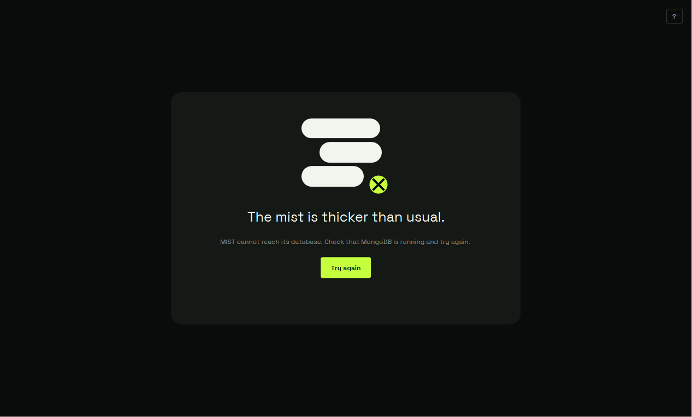

Check that the database is running and press **Try again**. If it is still unreachable, the message *Still no
connection.* appears under the button. The **?** button in the top right corner opens the help.

**Demo accounts.** A new installation comes with sample data. Every demo account uses the password `mist2026`:

| Account | Email |
| --- | --- |
| Player | `lucia@mist.com` (also `marc@mist.com`, `nora@mist.com`) |
| Developer | `rockstarnorth@mist.com` |
| Admin | `admin@mist.com` |

## 2. Logging in and creating an account

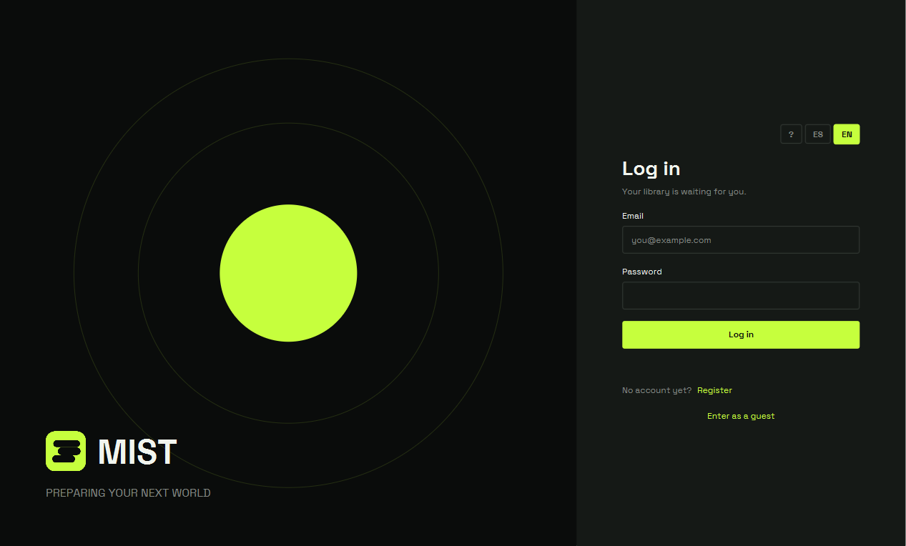

- Type your **Email** and **Password** and press **Log in** (or Enter). If either is wrong, MIST says *The email or
  password is wrong.* It never tells you which one, so nobody can find out which accounts exist.
- **ES** and **EN** at the top switch the language at once; the email you typed stays.
- **Enter as a guest** opens the store without an account. Guests can look at every game but must log in to buy.
- **Register** opens the registration form.

### Creating an account

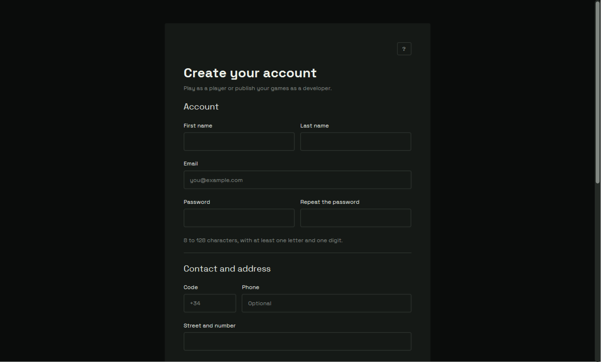

1. Fill in **Account**: first name, last name, email and password (twice). The password needs 8 to 128 characters,
   with at least one letter and one digit.
2. Fill in **Contact and address**. The phone is optional, but if you give it, give both the code (for example
   `+34`) and the number. Street, postal code, city and country are required.
3. Choose the **Account type**:
   - **Player**: a nickname (3 to 24 letters, digits, dots, dashes or underscores) and the card you will pay with.
     MIST keeps only the card's brand, holder, last four digits and expiry date; the full number is never stored.
   - **Developer**: your studio's name and the IBAN your sales are paid into.
4. Press **Create account**. MIST takes you back to login with your email filled in.

A field with a problem is outlined in red, and the message under the form says what is wrong. If the email, the
nickname or the studio name is already taken, that field is marked. **I already have an account** goes back to login.

## 3. Moving around

After you log in, the window keeps a header at the top:

- On the left, the sections of your account type: **Store**, **Library**, **Wishlist** and **Cart** for players
  (the cart shows how many games it holds), **Studio** for developers, **Log** for admins.
- On the right, the **user menu** with your name or photo: **Profile**, **Language** (Español or English),
  **Theme** (Dark or Light), **Help**, **Operation log** (admins only) and **Log out**. Your language and theme are
  saved in your account, so they come back the next time you log in.

### Help

**F1**, the user menu's **Help**, or a **?** button open the help window on the topic of the screen you are on. Pick
another topic in the list on the left. In a dialog, **?** opens the topic of the screen underneath, which explains
the dialog.

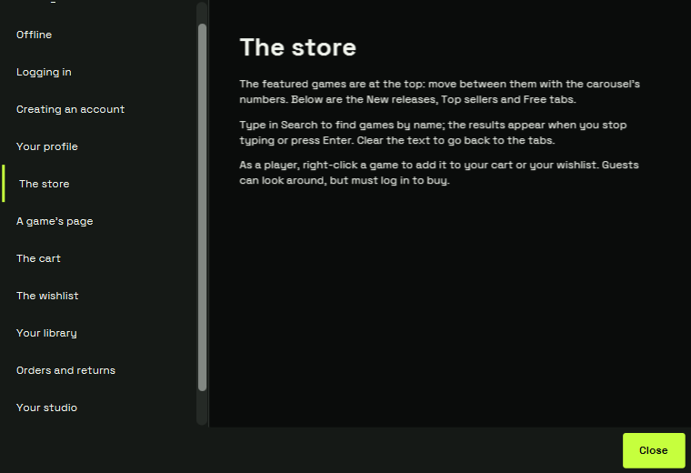

### Waiting and errors

While MIST works, the button you pressed is disabled for a moment. When something fails, MIST shows a message:

- A **warning** means a value breaks a rule, for example an expired card. Fix it and try again.
- An **error with Retry** means the database could not be reached. Press **Retry** once the connection is back;
  what you were doing runs again.

[Section 8](#8-messages-and-what-to-do) lists the messages.

## 4. For players

### The store

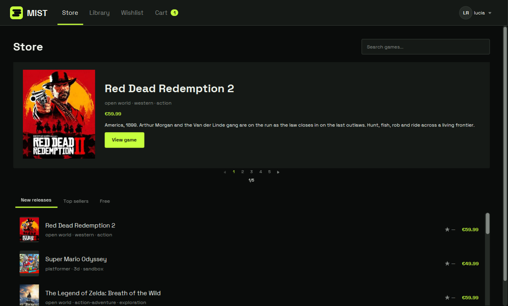

- The **featured games** carousel at the top: move between them with its numbers or arrows, and press **View game**.
- The **New releases**, **Top sellers** and **Free** tabs list games with their cover, tags, rating and price.
- **Search games...** finds games by name as you type; clear it to go back to the tabs.
- Double-click a game, or press Enter, to open its page. Right-click it to open it, add it to the cart or add it to
  the wishlist.

### A game's page

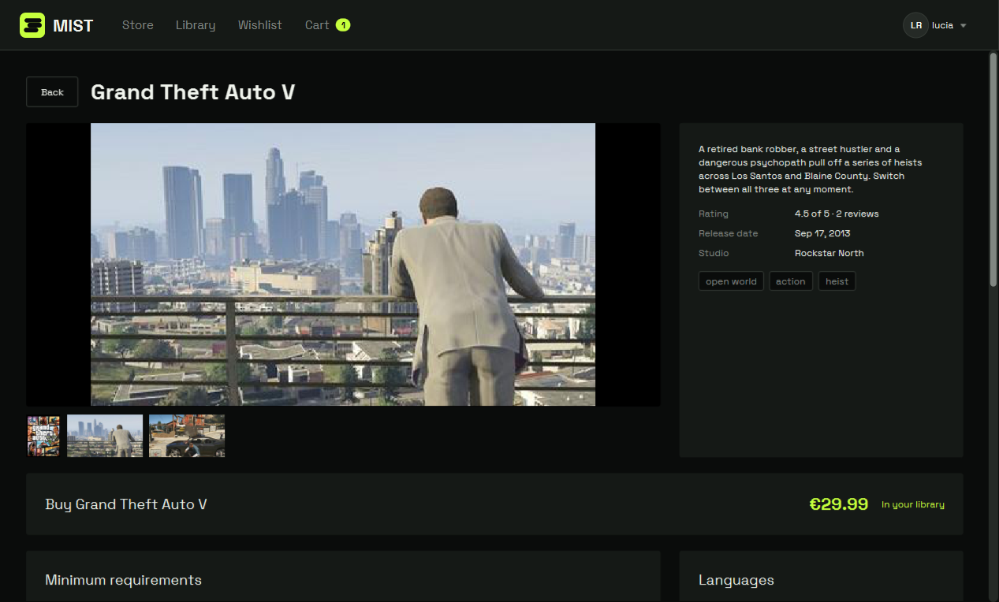

The page shows the images (click a thumbnail to see it large), the description, the average rating, the release
date, the studio, the tags, the minimum requirements, the languages, the PEGI rating, the achievements and the
reviews of other players, five per page.

In the buy box:

- **Add to cart**, then **Go to cart** to pay.
- **Add to wishlist** to keep the game for later.
- **In your library** appears instead if you already own the game, and **Write a review** if you have not reviewed it
  yet.

Right-click an achievement (**Copy achievement**) or a review (**Copy review**) to copy its text. **Back** returns
to the previous screen.

### The cart and checking out

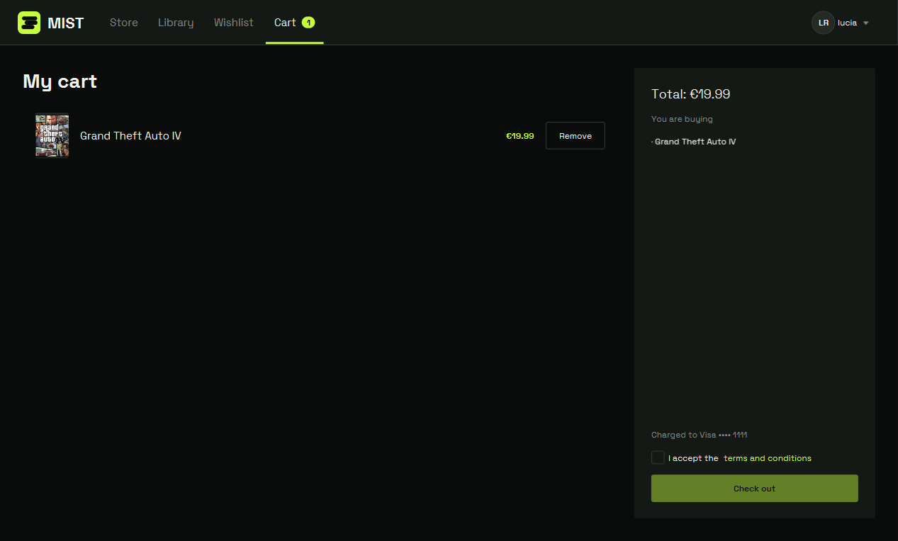

1. Check the games in the cart. **Remove** takes one out; right-click a game to open it or **Move to wishlist**.
2. The summary on the right shows the total and the card it will be charged to.
3. Tick **I accept the terms and conditions** (the link opens them) and press **Check out**.
4. MIST asks you to confirm the amount. After the payment, the games are in your library, and **Download the
   receipt** saves it as a PDF.

A cart holds up to 50 games. If your card has expired, change it in your [profile](#7-your-profile) first.

### The wishlist

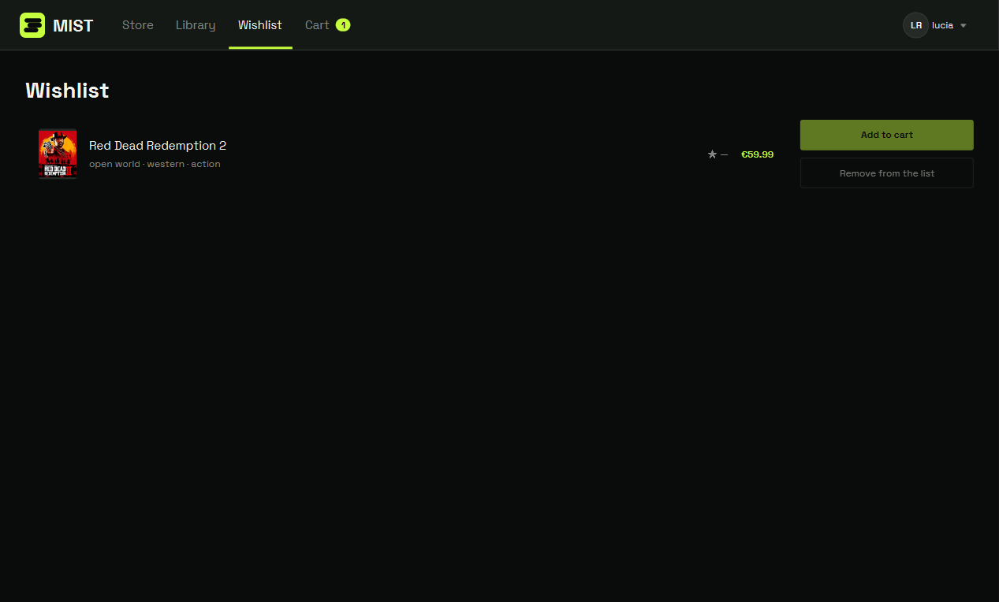

Select a game and press **Add to cart** to move it to the cart, or **Remove from the list**. Double-click a game to
open its page. A game that is no longer on sale cannot be moved to the cart.

### Your library

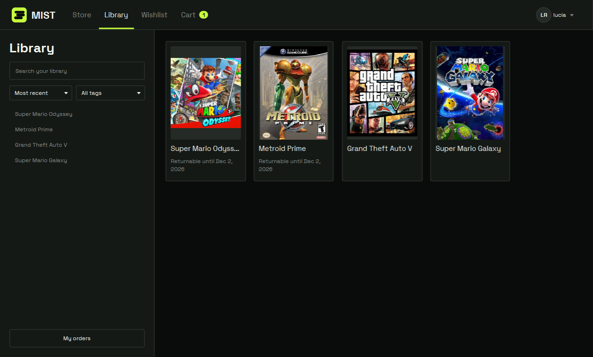

All the games you own, with their names on the left and their covers on the right.

- **Search your library** filters by name; the sort box orders by most recent or by name; the tag box shows only the
  games with that tag.
- Double-click a game (or press Enter) to open its page.
- Right-click a game to **Write a review** or **Return** it. Games you can still return show until which day.
- **My orders** opens your orders.

### Writing a review

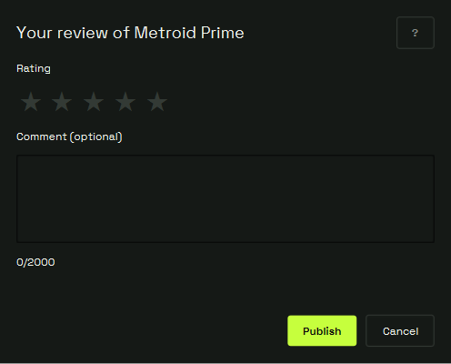

Choose 1 to 5 stars, write a comment if you like (up to 2000 characters; the counter shows how many you have used)
and press **Publish**. You can review each game you own once, and the review then appears on the game's page.

### Orders and returns

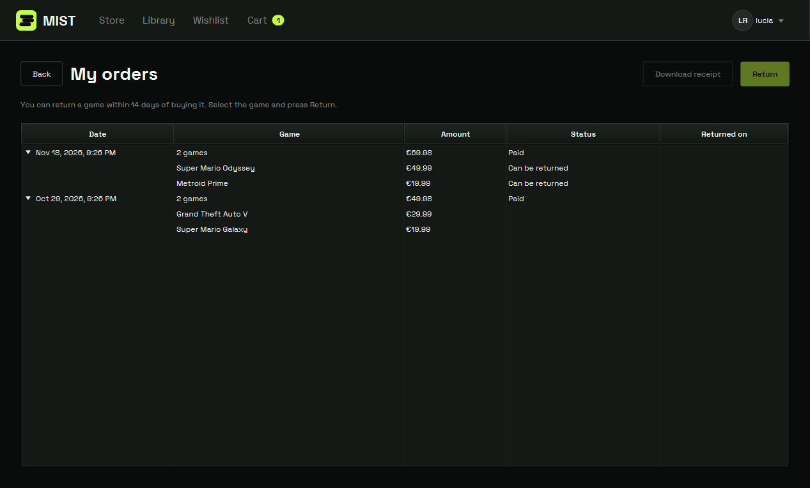

Each order shows its date, its amount and its status, with the games bought in it below.

- **Return** gives back a game within 14 days of buying it: select the game, press **Return** and confirm. The
  money goes back to the card the order was paid with, and the game leaves your library. The order then shows as
  partly or fully refunded, with the date of each return.
- **Download receipt** saves the selected order's receipt as a PDF, where you choose.

## 5. For developers

### Your studio dashboard

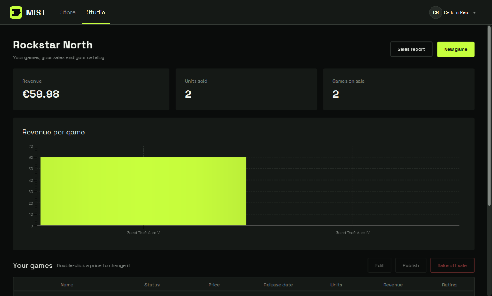

- At the top, your **Revenue**, the **Units sold** and how many **Games on sale** you have, and a chart of the
  revenue per game.
- **Sales report** saves these figures as a PDF.
- **Your games** lists all your games, drafts included, with their status, price, release date, units, revenue and
  rating.
  - **Change a price in place:** double-click the price, type the new one and press Enter. If MIST cannot save it,
    the old price comes back and a message says why.
  - **Edit** (or a double click on the name) opens the game in the editor.
  - **Publish** puts a draft on sale; **Take off sale** removes a published game from the store. Players who own it
    keep it. Right-click a game for the same actions.

### Creating a game

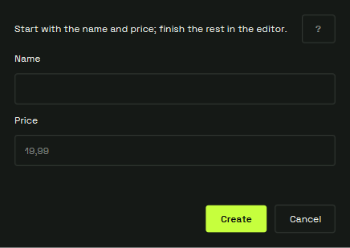

**New game** asks only for a **Name** and a **Price** (type `12,99`, `12.99` or `12,99 €`). **Create** saves the game
as a draft and opens it in the editor.

### The game editor

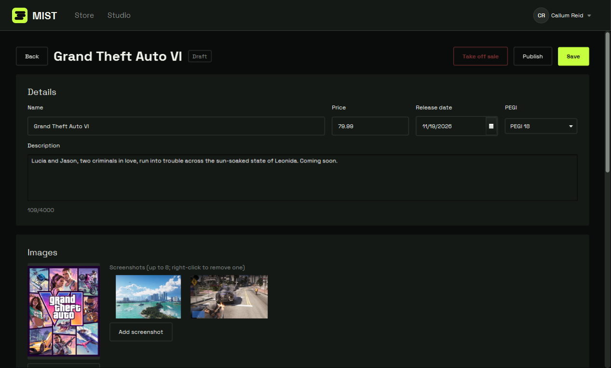

- **Details:** name, price (0 to 999.99), release date, PEGI rating and description. Press **Save** to keep your
  changes.
- **Images:** **Change cover** and **Add screenshot** upload a PNG, JPEG or GIF image of up to 2 MB; a game has up to
  8 screenshots. Right-click a screenshot to remove it.
- **Minimum requirements:** fill in all five or none.
- **Tags:** type one and press **Add** (up to 10); the cross on a tag removes it. **Languages:** tick the ones the
  game supports.
- **Achievements:** double-click a name or a description to change it, and press Enter. **Add achievement** and
  **Remove achievement** (or right-click the table) add a row or remove the selected one. They are saved with
  **Save**.
- **Publish** puts the draft on sale. A game needs a cover, a description, a release date, a PEGI rating and the
  requirements; whatever is missing is outlined in red. **Take off sale** removes a published game from the store.
- **Back** returns to the dashboard.

## 6. For admins: the operation log

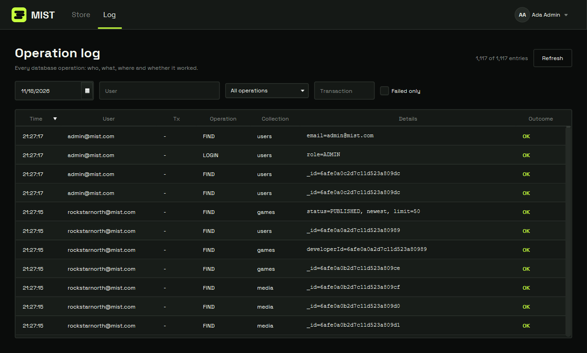

Every operation MIST makes on the database is written to a log file. This screen lets you read and filter it.

- Each line shows the **Time**, the **User** (the email of the person, or the email being tried during a login or a
  registration), the **Tx** number of the transaction it belongs to (`-` if none), the **Operation**, the
  **Collection**, the **Details** and the **Outcome** (OK or FAILED). Hover over the details to read them whole.
- Pick the **Day** in the calendar; only days with a log can be picked.
- Filter by **User**, by operation, by **Transaction** number, or tick **Failed only**. The count at the top shows how
  many lines match.
- Right-click a line to **Copy the line**, or show only its user, its operation or its transaction. A transaction
  starts with `BEGIN` and ends with `COMMIT` (saved) or `ROLLBACK` (undone): filtering by its number shows every
  operation that was saved or undone together.
- **Refresh** reads the log again, keeping the day.

## 7. Your profile

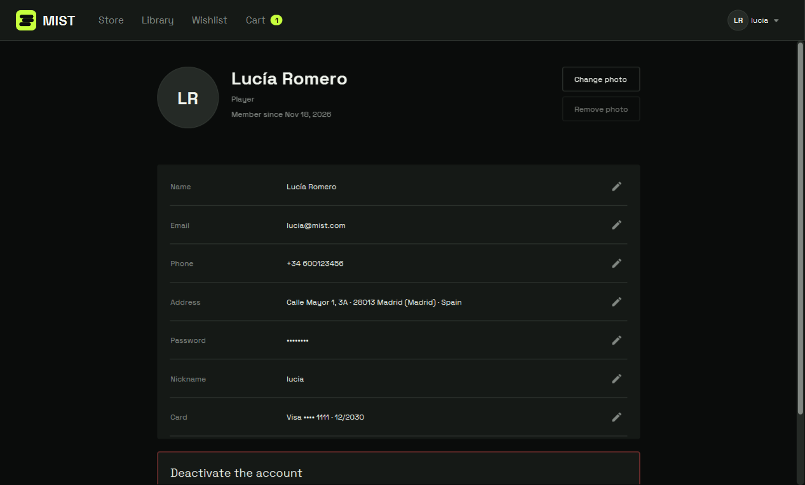

Open it from the user menu (**Profile**, or Ctrl+P).

- Each row shows one part of your account. Press the pencil to edit it in the row, then **Save** or **Cancel**. Only
  one row can be edited at a time.
- **Password:** type the current one, then the new one twice.
- **Card** (players): type the new card's full number; only its last four digits are kept.
- **Studio name** and **Bank account** (developers): the IBAN is shown masked.
- **Change photo** uploads a PNG, JPEG or GIF image of up to 2 MB; **Remove photo** goes back to your initials.
- **Deactivate** closes your account after asking you to confirm. You cannot log in again, and a developer's
  published games leave the store.

## 8. Messages and what to do

| Message | What it means and what to do |
| --- | --- |
| *The email or password is wrong.* | Check both and try again. |
| *This account has been deactivated.* | The account was closed; you are taken back to login. |
| *Use 8 to 128 characters, with at least one letter and one digit.* | Choose a stronger password. |
| *An account with that email already exists.* / *That nickname is already taken.* / *That studio name is already taken.* | Choose another one. |
| *You already own this game.* | It is already in your library. |
| *This game is not on sale.* | The developer took it off sale; it cannot be bought. |
| *The card has expired.* | Change the card in your profile. |
| *An order must have between 1 and 50 games.* | Remove games from the cart. |
| *This game can no longer be returned.* | The 14 days to return it are over. |
| *You have already reviewed this game.* | Each game can be reviewed once. |
| *Add a cover, description, release date, PEGI rating and requirements before publishing.* | Complete what is outlined in red in the editor. |
| *The image must be smaller than 2 MB.* | Choose a smaller image. |
| *The file could not be read.* | The file was moved, deleted or is in use; choose it again. |
| *The report could not be saved. Choose another folder or check that the file is not open.* | Close the PDF if it is open, or save it elsewhere. |
| *Could not reach the database. Try again in a moment.* | The connection was lost. Press **Retry** once it is back. |
| *The database rejected the data because a value breaks a rule of the data model.* | A value is not accepted; check the fields. |
| *Something went wrong. Try again; if it keeps happening, restart MIST.* | An unexpected error; it is written to MIST's log for the developers. |

## 9. Keyboard shortcuts

| Keys | Action |
| --- | --- |
| F1 | Help on the current screen |
| Ctrl+P | Your profile |
| Ctrl+L | Operation log (admins) |
| Ctrl+Shift+Q | Log out |
| Enter | Open the selected game in a list; press the form's main button |
| Delete | Remove the selected game from the cart |
| Esc | Cancel a dialog |
